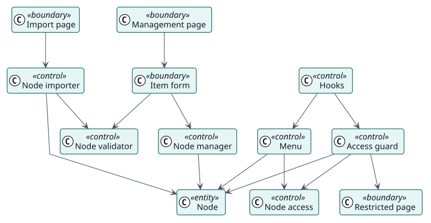

# Analysis

## Analysis classes

Stereotypes: `<<boundary>>` interface, `<<control>>` coordination, `<<entity>>` domain information.

| Class | Stereotype | Responsibility |
| --- | --- | --- |
| Management page, Item form, Import page, Restricted page | boundary | The screens through which administrators work and the page that explains a blocked user. |
| Node manager | control | Creates, changes, deletes and reorders nodes. |
| Node validator | control | Refuses the nodes that are not valid. |
| Node importer | control | Imports and exports nodes, checking the whole file first. |
| Hooks | control | Builds the menus and checks each page when Moodle asks. |
| Menu | control | Puts the nodes of a menu where Moodle expects them. |
| Node access | control | Tells whether a node is shown to a user and a language. |
| Access guard | control | Decides whether a page is blocked and where to send the user. |
| Node | entity | The stored information. |

## Use-case realizations

| ID | Use case | Collaboration |
| --- | --- | --- |
| UC-001 | [Add, change or delete an item](./use-cases/manageNodes/README.md) | [collaboration](./use-cases/manageNodes/collaboration.svg) |
| UC-002 | [Reorder the items](./use-cases/reorderNodes/README.md) | [collaboration](./use-cases/reorderNodes/collaboration.svg) |
| UC-003 | [Import and export items](./use-cases/importNodes/README.md) | [collaboration](./use-cases/importNodes/collaboration.svg) |
| UC-004 | [Show the menus of a user](./use-cases/showMenus/README.md) | [collaboration](./use-cases/showMenus/collaboration.svg) |
| UC-005 | [Block the pages of hidden items](./use-cases/blockUrl/README.md) | [collaboration](./use-cases/blockUrl/collaboration.svg) |
