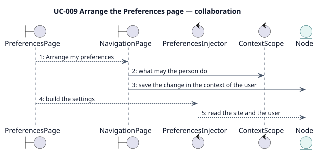

# UC-009 Arrange the Preferences page — analysis realization

| Overview | Requirements | Analysis | Design | Implementation | Tests |
| --- | --- | --- | --- | --- | --- |
| [Use cases](../../../requirements/use-case-overview.svg) | [Requirements](../../../requirements/use-cases/arrangePreferences/README.md) | **Analysis** | [Design](../../../design/use-cases/arrangePreferences/README.md) | [Implementation](../../../implementation/use-cases/arrangePreferences/README.md) | [Tests](../../../implementation/use-cases/arrangePreferences/README.md#tests) |

Requirements: [README](../../../requirements/use-cases/arrangePreferences/README.md)

## Participating classes

| Class | Stereotype | Responsibility |
| --- | --- | --- |
| PreferencesPage | boundary | The page Preferences of Moodle, with the section of the plugin. |
| NavigationPage | boundary | The list of the sections and options, in the context of the user. |
| PreferencesInjector | control | Reads the sections and options of the settings of a user and applies what the site and the user changed. |
| ContextScope | control | Says what the person may do in the context of a user. |
| Node | entity | The row of a section or an option. |

## Collaboration

## Notes

The user menu and the profile are not part of this use case: the profile is built by Moodle and keeps its boxes.
