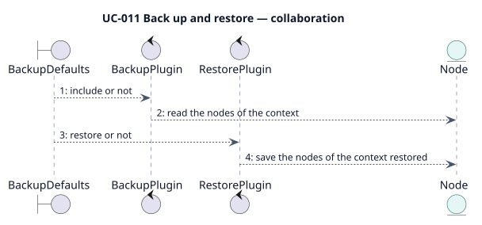

# UC-011 Back up and restore the changes of a course — analysis realization

| Overview | Requirements | Analysis | Design | Implementation | Tests |
| --- | --- | --- | --- | --- | --- |
| [Use cases](../../../requirements/use-case-overview.svg) | [Requirements](../../../requirements/use-cases/backUpChanges/README.md) | **Analysis** | [Design](../../../design/use-cases/backUpChanges/README.md) | [Implementation](../../../implementation/use-cases/backUpChanges/README.md) | [Tests](../../../implementation/use-cases/backUpChanges/README.md#tests) |

Requirements: [README](../../../requirements/use-cases/backUpChanges/README.md)

## Participating classes

| Class | Stereotype | Responsibility |
| --- | --- | --- |
| BackupDefaults | boundary | The defaults of the backups and of the restores. |
| BackupPlugin | control | Adds the nodes of the context to the backup. |
| RestorePlugin | control | Reads the nodes and gives them to the context restored. |
| Node | entity | A change of the course or of an activity. |

## Collaboration

## Notes

The changes are read and written by context, so a backup of one activity holds the changes of that activity only.
