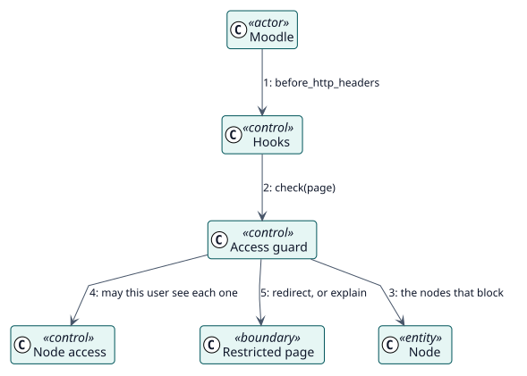

# UC-005 Block the pages of hidden items — analysis realization

| Overview | Requirements | Analysis | Design | Implementation | Tests |
| --- | --- | --- | --- | --- | --- |
| [Use cases](../../../requirements/use-case-overview.svg) | [Requirements](../../../requirements/use-cases/blockUrl/README.md) | **Analysis** | [Design](../../../design/use-cases/blockUrl/README.md) | [Implementation](../../../implementation/use-cases/blockUrl/README.md) | [Tests](../../../implementation/use-cases/blockUrl/README.md#tests) |

Requirements: [README](../../../requirements/use-cases/blockUrl/README.md)

## Participating classes

| Class | Stereotype | Responsibility |
| --- | --- | --- |
| Hooks | control | Run the guard before each page. |
| Access guard | control | Decides whether the page is blocked and where to send the user. |
| Node access | control | Tells whether the user sees each node. |
| Restricted page | boundary | Explains that the page is not available. |
| Node | entity | The items that block. |

## Collaboration

## Notes

A URL with query parameters only blocks the pages that have them.
