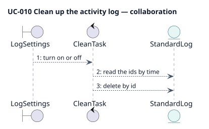

# UC-010 Clean up the activity log — analysis realization

| Overview | Requirements | Analysis | Design | Implementation | Tests |
| --- | --- | --- | --- | --- | --- |
| [Use cases](../../../requirements/use-case-overview.svg) | [Requirements](../../../requirements/use-cases/cleanActivityLog/README.md) | **Analysis** | [Design](../../../design/use-cases/cleanActivityLog/README.md) | [Implementation](../../../implementation/use-cases/cleanActivityLog/README.md) | [Tests](../../../implementation/use-cases/cleanActivityLog/README.md#tests) |

Requirements: [README](../../../requirements/use-cases/cleanActivityLog/README.md)

## Participating classes

| Class | Stereotype | Responsibility |
| --- | --- | --- |
| LogSettings | boundary | The page of the settings of the activity log. |
| CleanTask | control | Turns itself on and off with the settings and deletes the old entries. |
| StandardLog | entity | The log of Moodle, where the entries are. |

## Collaboration

## Notes

The progress is kept in the setting `logretention_done`; changing the time kept does not make the task read the log again from the start.
