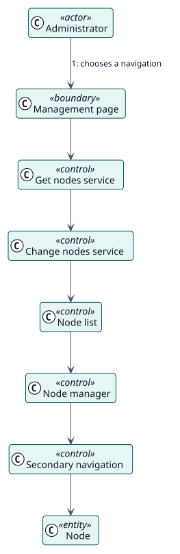

# UC-006 Customise a secondary navigation — analysis realization

| Overview | Requirements | Analysis | Design | Implementation | Tests |
| --- | --- | --- | --- | --- | --- |
| [Use cases](../../../requirements/use-case-overview.svg) | [Requirements](../../../requirements/use-cases/customiseSecondaryNavigation/README.md) | **Analysis** | [Design](../../../design/use-cases/customiseSecondaryNavigation/README.md) | [Implementation](../../../implementation/use-cases/customiseSecondaryNavigation/README.md) | [Tests](../../../implementation/use-cases/customiseSecondaryNavigation/README.md#tests) |

Requirements: [README](../../../requirements/use-cases/customiseSecondaryNavigation/README.md)

## Participating classes

| Class | Stereotype | Responsibility |
| --- | --- | --- |
| Management page | boundary | Lists the navigations and the nodes, and sends every change. |
| Get nodes service | control | Returns one page of the nodes with the counts of each visibility. |
| Change nodes service | control | Shows, hides, deletes and moves nodes. |
| Node list | control | Filters the nodes and describes each row. |
| Node manager | control | Writes the rows and the order. |
| Secondary navigation | control | Applies the nodes to the navigation of a page. |
| Node | entity | A node of a navigation and its rules. |

## Collaboration

