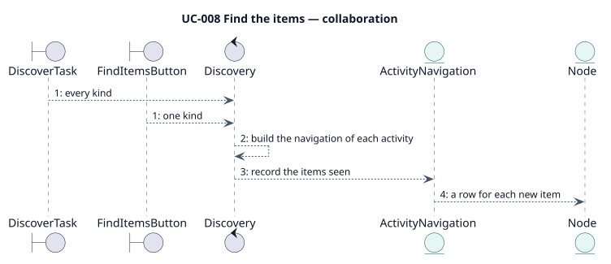

# UC-008 Find the items of the navigation of each kind of activity — analysis realization

| Overview | Requirements | Analysis | Design | Implementation | Tests |
| --- | --- | --- | --- | --- | --- |
| [Use cases](../../../requirements/use-case-overview.svg) | [Requirements](../../../requirements/use-cases/discoverActivityItems/README.md) | **Analysis** | [Design](../../../design/use-cases/discoverActivityItems/README.md) | [Implementation](../../../implementation/use-cases/discoverActivityItems/README.md) | [Tests](../../../implementation/use-cases/discoverActivityItems/README.md#tests) |

Requirements: [README](../../../requirements/use-cases/discoverActivityItems/README.md)

## Participating classes

| Class | Stereotype | Responsibility |
| --- | --- | --- |
| DiscoverTask | boundary | Starts the search once a day, as an administrator. |
| FindItemsButton | boundary | Starts the search of one kind from its list. |
| Discovery | control | Takes the activities of a kind and builds their navigation. |
| ActivityNavigation | entity | The navigation of one kind of activity, with the items found. |
| Node | entity | The row of an item, which can be changed. |

## Collaboration

## Notes

The navigation is built, never shown: nothing reaches a browser, and the activities are not changed.
