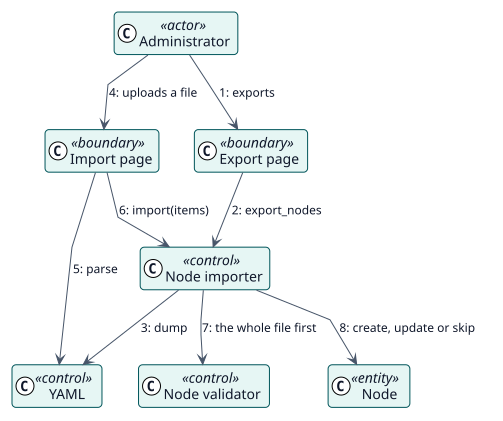

# UC-003 Import and export items — analysis realization

| Overview | Requirements | Analysis | Design | Implementation | Tests |
| --- | --- | --- | --- | --- | --- |
| [Use cases](../../../requirements/use-case-overview.svg) | [Requirements](../../../requirements/use-cases/importNodes/README.md) | **Analysis** | [Design](../../../design/use-cases/importNodes/README.md) | [Implementation](../../../implementation/use-cases/importNodes/README.md) | [Tests](../../../implementation/use-cases/importNodes/README.md#tests) |

Requirements: [README](../../../requirements/use-cases/importNodes/README.md)

## Participating classes

| Class | Stereotype | Responsibility |
| --- | --- | --- |
| Import page | boundary | Collects the file and the choice. |
| Export page | boundary | Downloads the file. |
| YAML | control | Reads and writes the format. |
| Node importer | control | Validates and imports, or exports. |
| Node validator | control | Refuses invalid items. |
| Node | entity | The item that is created or updated. |

## Collaboration

## Notes

The same description of the fields is shown on the import page and offers an example file.
