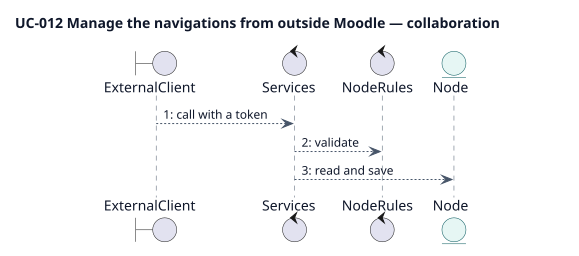

# UC-012 Manage the navigations from outside Moodle — analysis realization

| Overview | Requirements | Analysis | Design | Implementation | Tests |
| --- | --- | --- | --- | --- | --- |
| [Use cases](../../../requirements/use-case-overview.svg) | [Requirements](../../../requirements/use-cases/manageByWebService/README.md) | **Analysis** | [Design](../../../design/use-cases/manageByWebService/README.md) | [Implementation](../../../implementation/use-cases/manageByWebService/README.md) | [Tests](../../../implementation/use-cases/manageByWebService/README.md#tests) |

Requirements: [README](../../../requirements/use-cases/manageByWebService/README.md)

## Participating classes

| Class | Stereotype | Responsibility |
| --- | --- | --- |
| ExternalClient | boundary | The system outside Moodle. |
| Services | control | The functions: list, save, change, export, import and search. |
| NodeRules | control | The checks of a node and of an import file. |
| Node | entity | A row of the navigation. |

## Collaboration

## Notes

The search of what a file can hold (navigations, kinds of activity, users, courses, categories) is a service too, which returns ten results at a time.
