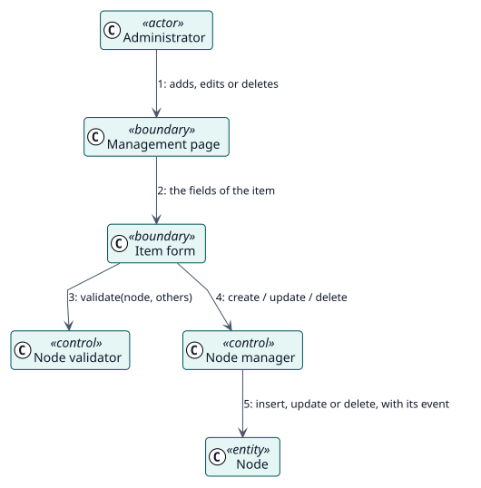

# UC-001 Add, change or delete an item — analysis realization

| Overview | Requirements | Analysis | Design | Implementation | Tests |
| --- | --- | --- | --- | --- | --- |
| [Use cases](../../../requirements/use-case-overview.svg) | [Requirements](../../../requirements/use-cases/manageNodes/README.md) | **Analysis** | [Design](../../../design/use-cases/manageNodes/README.md) | [Implementation](../../../implementation/use-cases/manageNodes/README.md) | [Tests](../../../implementation/use-cases/manageNodes/README.md#tests) |

Requirements: [README](../../../requirements/use-cases/manageNodes/README.md)

## Participating classes

| Class | Stereotype | Responsibility |
| --- | --- | --- |
| Management page | boundary | Lists the items and their actions. |
| Item form | boundary | Collects the fields of an item. |
| Node validator | control | Refuses the invalid items. |
| Node manager | control | Creates, changes and deletes nodes. |
| Node | entity | The stored item. |

## Collaboration

## Notes

The same manager is used by the form, by the import and by the synchronisation with the custom menu items of Moodle.
