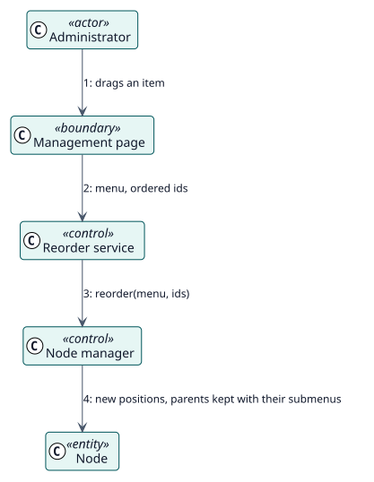

# UC-002 Reorder the items — analysis realization

| Overview | Requirements | Analysis | Design | Implementation | Tests |
| --- | --- | --- | --- | --- | --- |
| [Use cases](../../../requirements/use-case-overview.svg) | [Requirements](../../../requirements/use-cases/reorderNodes/README.md) | **Analysis** | [Design](../../../design/use-cases/reorderNodes/README.md) | [Implementation](../../../implementation/use-cases/reorderNodes/README.md) | [Tests](../../../implementation/use-cases/reorderNodes/README.md#tests) |

Requirements: [README](../../../requirements/use-cases/reorderNodes/README.md)

## Participating classes

| Class | Stereotype | Responsibility |
| --- | --- | --- |
| Management page | boundary | Shows the handles and the list of positions. |
| Reorder service | control | Receives the ids in their new order. |
| Node manager | control | Writes the positions. |
| Node | entity | The item that moves. |

## Collaboration

## Notes

The position of each item is exported in the field `order`, so an import keeps it.
