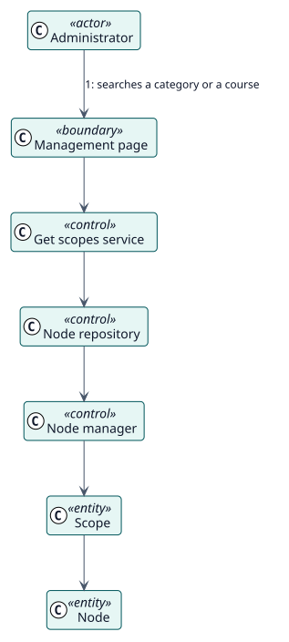

# UC-007 Change a navigation for a category or a course — analysis realization

| Overview | Requirements | Analysis | Design | Implementation | Tests |
| --- | --- | --- | --- | --- | --- |
| [Use cases](../../../requirements/use-case-overview.svg) | [Requirements](../../../requirements/use-cases/setScopeException/README.md) | **Analysis** | [Design](../../../design/use-cases/setScopeException/README.md) | [Implementation](../../../implementation/use-cases/setScopeException/README.md) | [Tests](../../../implementation/use-cases/setScopeException/README.md#tests) |

Requirements: [README](../../../requirements/use-cases/setScopeException/README.md)

## Participating classes

| Class | Stereotype | Responsibility |
| --- | --- | --- |
| Management page | boundary | Chooses the scope and shows what it sees. |
| Get scopes service | control | Finds the categories and courses with changes and the ones a search finds. |
| Node repository | control | Returns the nodes that apply to a context, the nearest scope winning. |
| Node manager | control | Makes the exceptions and changes them. |
| Scope | entity | A category or a course that changes a navigation. |
| Node | entity | A node of a navigation and its rules. |

## Collaboration

