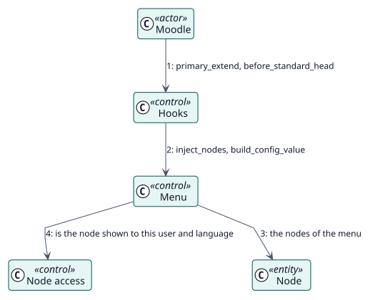

# UC-004 Show the menus of a user — analysis realization

| Overview | Requirements | Analysis | Design | Implementation | Tests |
| --- | --- | --- | --- | --- | --- |
| [Use cases](../../../requirements/use-case-overview.svg) | [Requirements](../../../requirements/use-cases/showMenus/README.md) | **Analysis** | [Design](../../../design/use-cases/showMenus/README.md) | [Implementation](../../../implementation/use-cases/showMenus/README.md) | [Tests](../../../implementation/use-cases/showMenus/README.md#tests) |

Requirements: [README](../../../requirements/use-cases/showMenus/README.md)

## Participating classes

| Class | Stereotype | Responsibility |
| --- | --- | --- |
| Hooks | control | Reacts to the hooks of Moodle. |
| Menu | control | Puts the nodes where Moodle expects them. |
| Node access | control | Tells whether a node is shown to a user and a language. |
| Node | entity | The item. |

## Collaboration

## Notes

The user menu is rewritten for each user in each request; the real settings are kept and restored on the pages of administration.
