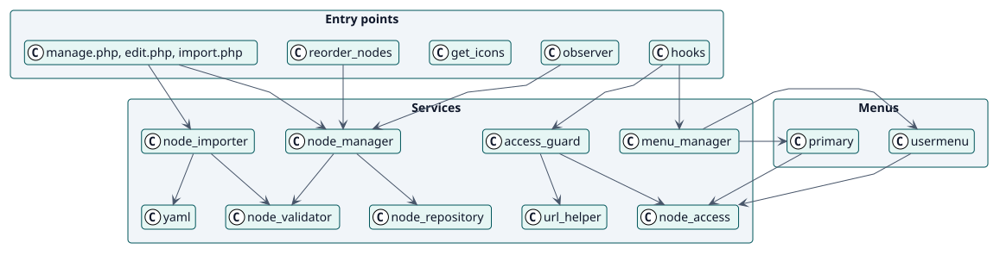
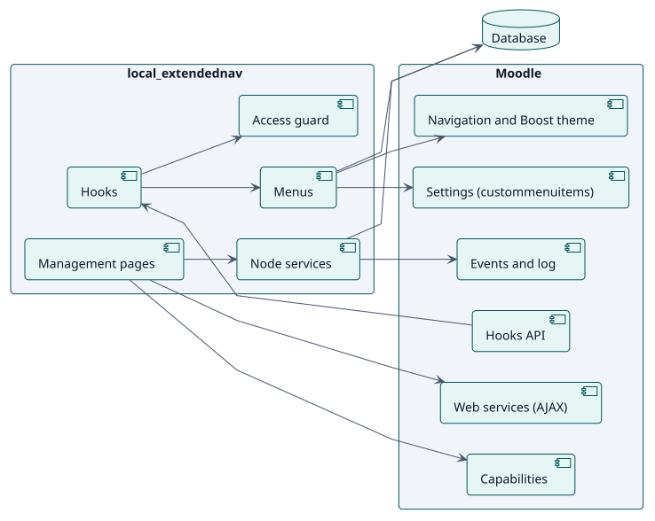
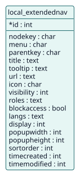

# Design

## Architecture

Extended navigation is a Moodle local plugin with three layers:

- **Entry points**: the management pages (`manage.php`, `edit.php`, `import.php`, `export.php`, `activity.php`), two web-service functions for ordering and icons, the hooks of Moodle and an observer.
- **Services**: classes in `classes/local/` and the menus of `classes/menu/`. `node_manager` and `node_importer` change nodes, `node_validator` refuses the invalid ones, `node_access` and `access_guard` decide who sees and who opens.
- **Persistence**: one table, `local_extendednav`.

Two decisions shape the design. First, **the menus are built on each request through the hooks API**, so a change shows at once and nothing of Moodle is rewritten in its tables. Second, **the guard reads the same nodes and the same rules as the menus**, so a page is blocked exactly for the users who do not see its item.

## Design classes

## Components

## Data model

## Use-case realizations

| ID | Use case | Sequence |
| --- | --- | --- |
| UC-001 | [Add, change or delete an item](./use-cases/manageNodes/README.md) | [sequence](./use-cases/manageNodes/sequence.svg) |
| UC-002 | [Reorder the items](./use-cases/reorderNodes/README.md) | [sequence](./use-cases/reorderNodes/sequence.svg) |
| UC-003 | [Import and export items](./use-cases/importNodes/README.md) | [sequence](./use-cases/importNodes/sequence.svg) |
| UC-004 | [Show the menus of a user](./use-cases/showMenus/README.md) | [sequence](./use-cases/showMenus/sequence.svg) |
| UC-005 | [Block the pages of hidden items](./use-cases/blockUrl/README.md) | [sequence](./use-cases/blockUrl/sequence.svg) |
