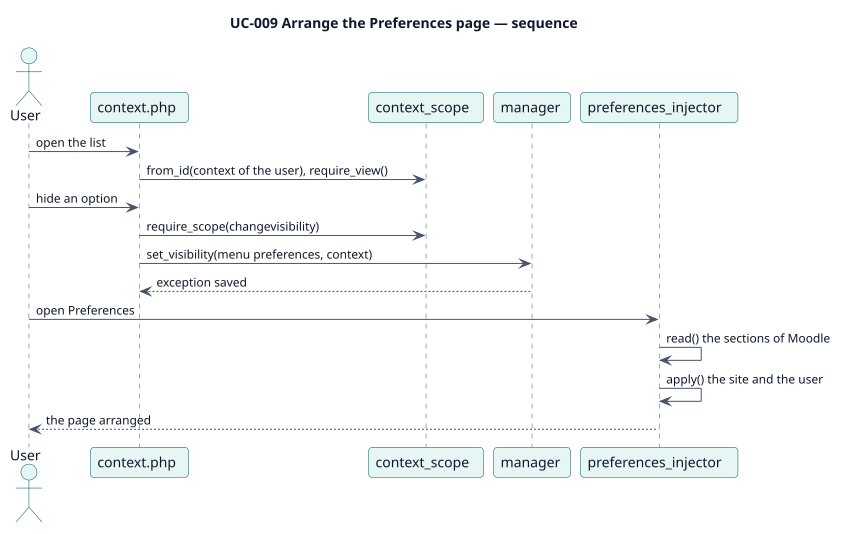

# UC-009 Arrange the Preferences page — design realization

| Overview | Requirements | Analysis | Design | Implementation | Tests |
| --- | --- | --- | --- | --- | --- |
| [Use cases](../../../requirements/use-case-overview.svg) | [Requirements](../../../requirements/use-cases/arrangePreferences/README.md) | [Analysis](../../../analysis/use-cases/arrangePreferences/README.md) | **Design** | [Implementation](../../../implementation/use-cases/arrangePreferences/README.md) | [Tests](../../../implementation/use-cases/arrangePreferences/README.md#tests) |

## Classes

| Analysis class | Design class | Notes |
| --- | --- | --- |
| PreferencesPage | `local_extendednav_extend_navigation_user_settings` (`lib.php`) | Calls the injector when Moodle builds the settings of a user. |
| NavigationPage | `context.php`, `templates/manage/page.mustache`, `amd/src/manage.js` | The same list as the other navigations, in folders. |
| PreferencesInjector | `local_extendednav\local\navigation\preferences_injector` | `read()`, `record()`, `apply()`, `order()`. |
| ContextScope | `local_extendednav\local\navigation\context_scope` | `is_user()`, `can()`, `PERSONAL`. |
| Node | table `local_extendednav` | Rows of the site and of the context of the user, by menu `preferences`. |

## Decisions

- The arrangement of a user is kept as exceptions of their context, as the changes of a course are, so the list, the order, the services, the export and the privacy of the plugin work on it with no code of their own.
- Moodle builds the sections with no key (Roles), and the options Moodle numbers: a section with no key is known by its first option, an option by the path of its URL.
- A user may change the visibility and the order of their page and rename its options; where an option leads is Moodle's.

## Sequence

