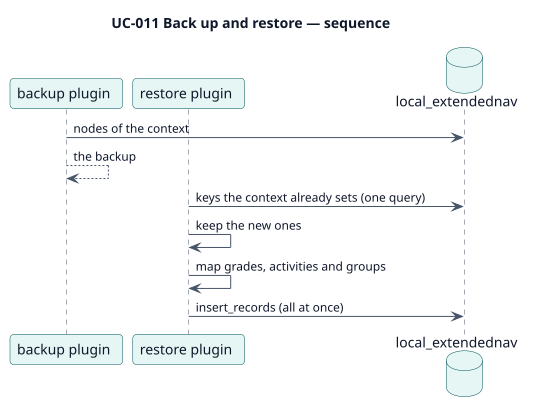

# UC-011 Back up and restore the changes of a course — design realization

| Overview | Requirements | Analysis | Design | Implementation | Tests |
| --- | --- | --- | --- | --- | --- |
| [Use cases](../../../requirements/use-case-overview.svg) | [Requirements](../../../requirements/use-cases/backUpChanges/README.md) | [Analysis](../../../analysis/use-cases/backUpChanges/README.md) | **Design** | [Implementation](../../../implementation/use-cases/backUpChanges/README.md) | [Tests](../../../implementation/use-cases/backUpChanges/README.md#tests) |

## Classes

| Analysis class | Design class | Notes |
| --- | --- | --- |
| BackupDefaults | `settings.php` | `backup_navigation` and `restore_navigation`, added to the pages of Moodle. |
| BackupPlugin | `backup_local_extendednav_plugin` | Source table `local_extendednav` by context. |
| RestorePlugin | `restore_local_extendednav_plugin` | `process_navigation_node()`, `map_activity_conditions()`. |
| Node | table `local_extendednav` | Rows with `contextid` of the course or the activity. |

## Decisions

- The rows to save are collected while the backup is read and inserted at once when the whole course is restored, so the conditions can point to the activities and grades that were restored.
- The keys already set in the context are read in one query for the context, not one query per node.

## Sequence

