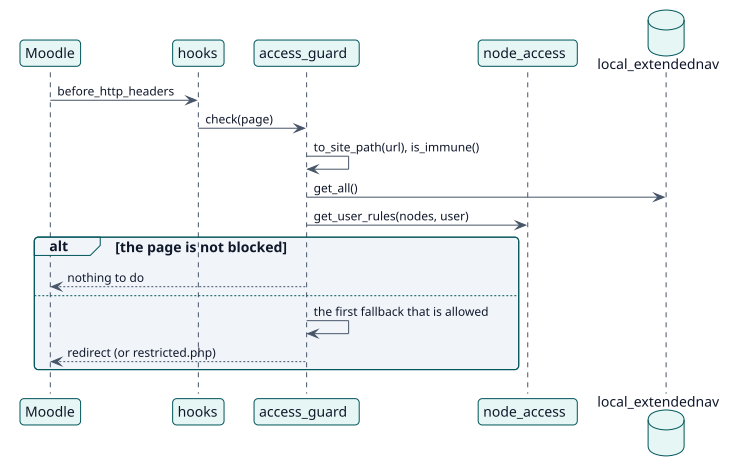

# UC-005 Block the pages of hidden items — design realization

| Overview | Requirements | Analysis | Design | Implementation | Tests |
| --- | --- | --- | --- | --- | --- |
| [Use cases](../../../requirements/use-case-overview.svg) | [Requirements](../../../requirements/use-cases/blockUrl/README.md) | [Analysis](../../../analysis/use-cases/blockUrl/README.md) | **Design** | [Implementation](../../../implementation/use-cases/blockUrl/README.md) | [Tests](../../../implementation/use-cases/blockUrl/README.md#tests) |

Analysis: [README](../../../analysis/use-cases/blockUrl/README.md)

## Elements

| Design element | Kind | Code target |
| --- | --- | --- |
| `hooks::before_http_headers` | hook | `classes/hooks.php:61` |
| `access_guard::check` | service | `classes/local/access_guard.php:51` |
| `access_guard::evaluate` | service | `classes/local/access_guard.php:79` |

## Sequence

## Contracts

| Operation | Input | Output | Errors |
| --- | --- | --- | --- |
| `access_guard::evaluate(current, userid)` | the site path and the user | null when allowed, the path to go to, or an empty string | none |

## Data touched

| Table or entity | Operation |
| --- | --- |
| `local_extendednav` | read |
