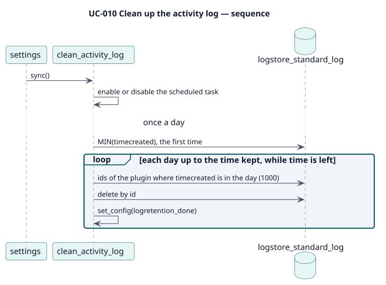

# UC-010 Clean up the activity log — design realization

| Overview | Requirements | Analysis | Design | Implementation | Tests |
| --- | --- | --- | --- | --- | --- |
| [Use cases](../../../requirements/use-case-overview.svg) | [Requirements](../../../requirements/use-cases/cleanActivityLog/README.md) | [Analysis](../../../analysis/use-cases/cleanActivityLog/README.md) | **Design** | [Implementation](../../../implementation/use-cases/cleanActivityLog/README.md) | [Tests](../../../implementation/use-cases/cleanActivityLog/README.md#tests) |

## Classes

| Analysis class | Design class | Notes |
| --- | --- | --- |
| LogSettings | `settings.php` | A checkbox and a duration with no upper limit; both call `clean_activity_log::sync` when saved. |
| CleanTask | `local_extendednav\task\clean_activity_log` | `sync()`, `clean()`, `is_wanted()`; schedule in `db/tasks.php`, off until the setting turns it on. |
| StandardLog | table `logstore_standard_log` | Read by `timecreated` and `component`. |

## Decisions

- The table has an index on the time and none on the component, so the task reads one day of time at a time and filters the component inside it.
- The ids are read in batches and deleted by their primary key, so no query touches the whole table and none holds a lock for long.
- The task is disabled, not only idle, while the clean-up is off, so it does not appear among the tasks that run.

## Sequence

