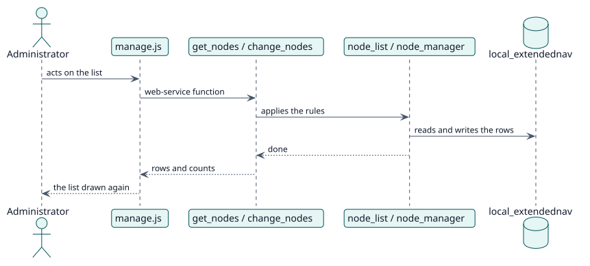

# UC-006 Customise a secondary navigation — design

| Overview | Requirements | Analysis | Design | Implementation | Tests |
| --- | --- | --- | --- | --- | --- |
| [Use cases](../../../requirements/use-case-overview.svg) | [Requirements](../../../requirements/use-cases/customiseSecondaryNavigation/README.md) | [Analysis](../../../analysis/use-cases/customiseSecondaryNavigation/README.md) | **Design** | [Implementation](../../../implementation/use-cases/customiseSecondaryNavigation/README.md) | [Tests](../../../implementation/use-cases/customiseSecondaryNavigation/README.md#tests) |

Analysis: [README](../../../analysis/use-cases/customiseSecondaryNavigation/README.md)

## Elements

| Design element | Kind | Code target |
| --- | --- | --- |
| `get_nodes::execute` | service | `classes/external/get_nodes.php` |
| `change_nodes::set_visibility`, `delete`, `move` | service | `classes/external/change_nodes.php` |
| `node_list::get` | service | `classes/local/node_list.php` |
| `node_manager::set_visibility`, `move` | service | `classes/local/node_manager.php` |
| `secondary::record_seen` | service | `classes/menu/secondary.php` |
| `secondary_navigation::apply` | service | `classes/local/secondary_navigation.php` |

## Sequence

## Contracts

| Operation | Input | Output | Errors |
| --- | --- | --- | --- |
| `local_extendednav_get_nodes(menu, contextid, search, visibility, parent, page, perpage)` | the navigation, the scope and the filters | rows, total, counts and whether the list can be reordered | no capability, unknown navigation, unsupported visibility |
| `local_extendednav_set_visibility(menu, contextid, nodekeys, visibility)` | the nodes and the new visibility | how many changed | no capability, visibility other than hidden or visible |
| `local_extendednav_move_node(menu, contextid, nodekey, direction)` | the node and the direction | how many moved | no capability, direction other than -1 or 1 |

## Data touched

| Table or entity | Operation |
| --- | --- |
| `local_extendednav` | select, insert (a node seen for the first time), update (visibility, position) |
| `config_plugins` (`nativenodes_<navigation>`) | update, once for each node seen |
