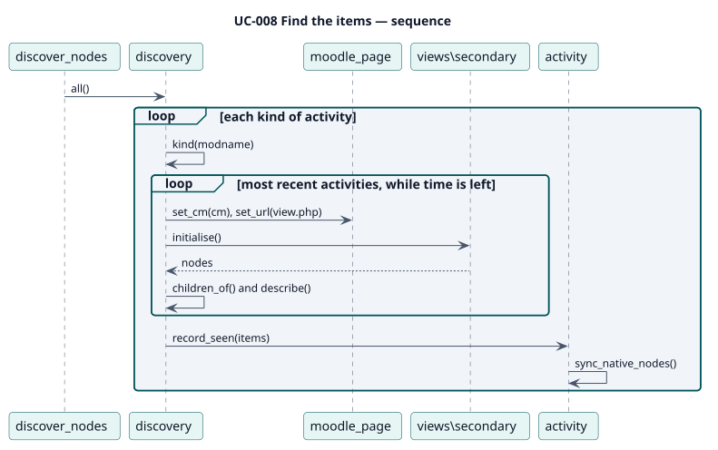

# UC-008 Find the items of the navigation of each kind of activity — design realization

| Overview | Requirements | Analysis | Design | Implementation | Tests |
| --- | --- | --- | --- | --- | --- |
| [Use cases](../../../requirements/use-case-overview.svg) | [Requirements](../../../requirements/use-cases/discoverActivityItems/README.md) | [Analysis](../../../analysis/use-cases/discoverActivityItems/README.md) | **Design** | [Implementation](../../../implementation/use-cases/discoverActivityItems/README.md) | [Tests](../../../implementation/use-cases/discoverActivityItems/README.md#tests) |

## Classes

| Analysis class | Design class | Notes |
| --- | --- | --- |
| DiscoverTask | `local_extendednav\task\discover_nodes` | Scheduled task, once a day at 03:00 (random minute). |
| FindItemsButton | `local_extendednav_discover_nodes` (web service), `amd/src/manage.js` | 30 activities, 8 seconds at most. |
| Discovery | `local_extendednav\local\navigation\discovery` | `kind()`, `all()`, `nodes_of()`. |
| ActivityNavigation | `local_extendednav\menu\activity` | Key `mod_<module>`; items in the setting `nativenodes_mod_<module>`. |
| Node | table `local_extendednav` | A row created by `base::sync_native_nodes`. |

## Decisions

- Moodle and its plugins read the page being built from the global `$PAGE`, so the page of the activity takes its place while the navigation is built and gives it back afterwards, also when building fails.
- The key of an item Moodle numbers is the path of its address (`secondary::key_of`), the same one the pages use, so the item found and the item shown are one.
- The most recent activities are looked through first: a plugin that adds an item to some activities is usually set up on the new ones.

## Sequence

