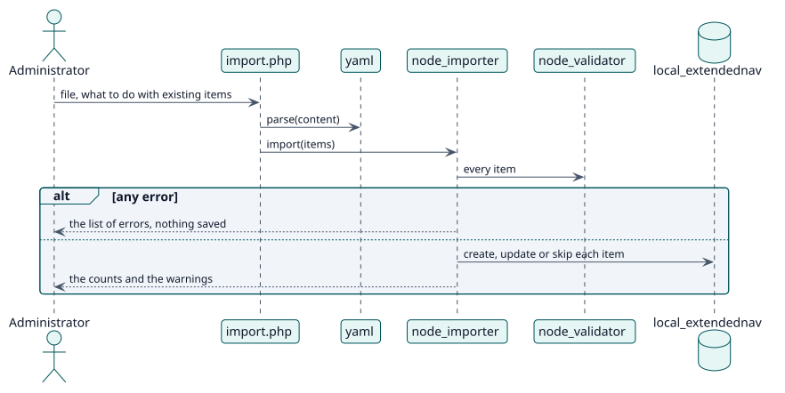

# UC-003 Import and export items — design realization

| Overview | Requirements | Analysis | Design | Implementation | Tests |
| --- | --- | --- | --- | --- | --- |
| [Use cases](../../../requirements/use-case-overview.svg) | [Requirements](../../../requirements/use-cases/importNodes/README.md) | [Analysis](../../../analysis/use-cases/importNodes/README.md) | **Design** | [Implementation](../../../implementation/use-cases/importNodes/README.md) | [Tests](../../../implementation/use-cases/importNodes/README.md#tests) |

Analysis: [README](../../../analysis/use-cases/importNodes/README.md)

## Elements

| Design element | Kind | Code target |
| --- | --- | --- |
| `node_importer::import` | service | `classes/local/node_importer.php:110` |
| `node_importer::export_nodes` | service | `classes/local/node_importer.php:66` |
| `yaml::parse` | service | `classes/yaml.php:61` |

## Sequence

## Contracts

| Operation | Input | Output | Errors |
| --- | --- | --- | --- |
| `node_importer::import(items)` | the items read from the file | the errors, the warnings and the counts | invalid items |

## Data touched

| Table or entity | Operation |
| --- | --- |
| `local_extendednav` | insert, update |
| `logstore_standard_log` | insert |
