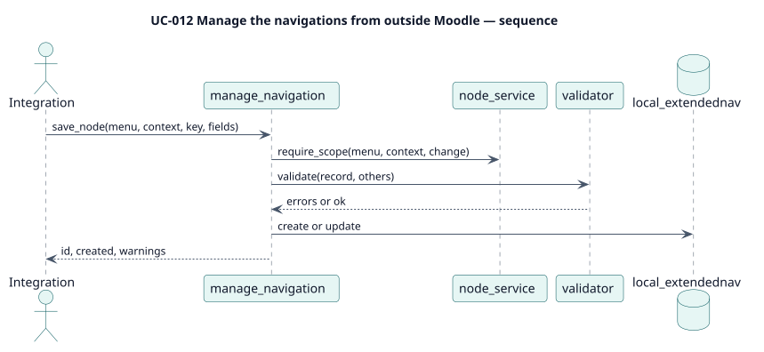

# UC-012 Manage the navigations from outside Moodle — design realization

| Overview | Requirements | Analysis | Design | Implementation | Tests |
| --- | --- | --- | --- | --- | --- |
| [Use cases](../../../requirements/use-case-overview.svg) | [Requirements](../../../requirements/use-cases/manageByWebService/README.md) | [Analysis](../../../analysis/use-cases/manageByWebService/README.md) | **Design** | [Implementation](../../../implementation/use-cases/manageByWebService/README.md) | [Tests](../../../implementation/use-cases/manageByWebService/README.md#tests) |

## Classes

| Analysis class | Design class | Notes |
| --- | --- | --- |
| ExternalClient | The service `local_extendednav` (restricted users) | Defined in `db/services.php` with every function of the plugin. |
| Services | `local_extendednav\external\manage_navigation`, `change_nodes`, `get_nodes`, `reorder_nodes`, `search_export` | Each function checks its scope with `node_service::require_scope`. |
| NodeRules | `local_extendednav\local\node\validator`, `local_extendednav\local\io\importer` | The same ones the form and the import page use. |
| Node | table `local_extendednav` |  |

## Decisions

- The services check the scope of a context with the same class the pages use, so a user, a course and a category keep their capabilities.
- A field that the capabilities of the context lock cannot be sent: the service refuses it instead of ignoring it.

## Sequence

