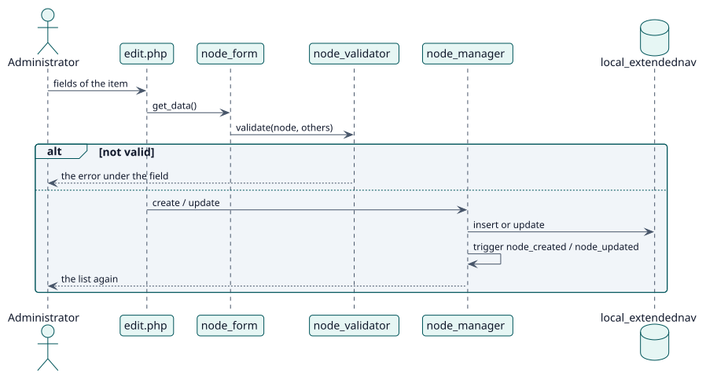

# UC-001 Add, change or delete an item — design realization

| Overview | Requirements | Analysis | Design | Implementation | Tests |
| --- | --- | --- | --- | --- | --- |
| [Use cases](../../../requirements/use-case-overview.svg) | [Requirements](../../../requirements/use-cases/manageNodes/README.md) | [Analysis](../../../analysis/use-cases/manageNodes/README.md) | **Design** | [Implementation](../../../implementation/use-cases/manageNodes/README.md) | [Tests](../../../implementation/use-cases/manageNodes/README.md#tests) |

Analysis: [README](../../../analysis/use-cases/manageNodes/README.md)

## Elements

| Design element | Kind | Code target |
| --- | --- | --- |
| `node_validator::validate` | service | `classes/local/node_validator.php:46` |
| `node_manager::create` | service | `classes/local/node_manager.php:104` |
| `node_manager::update` | service | `classes/local/node_manager.php:134` |
| `node_manager::delete` | service | `classes/local/node_manager.php:159` |

## Sequence

## Contracts

| Operation | Input | Output | Errors |
| --- | --- | --- | --- |
| `node_manager::create(record, events)` | the item | the saved record with its id | invalid item |

## Data touched

| Table or entity | Operation |
| --- | --- |
| `local_extendednav` | insert, update, delete |
| `logstore_standard_log` | insert (one event per change) |
