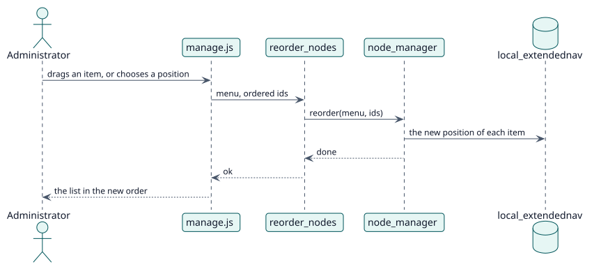

# UC-002 Reorder the items — design realization

| Overview | Requirements | Analysis | Design | Implementation | Tests |
| --- | --- | --- | --- | --- | --- |
| [Use cases](../../../requirements/use-case-overview.svg) | [Requirements](../../../requirements/use-cases/reorderNodes/README.md) | [Analysis](../../../analysis/use-cases/reorderNodes/README.md) | **Design** | [Implementation](../../../implementation/use-cases/reorderNodes/README.md) | [Tests](../../../implementation/use-cases/reorderNodes/README.md#tests) |

Analysis: [README](../../../analysis/use-cases/reorderNodes/README.md)

## Elements

| Design element | Kind | Code target |
| --- | --- | --- |
| `reorder_nodes::execute` | service | `classes/external/reorder_nodes.php:58` |
| `node_manager::reorder` | service | `classes/local/node_manager.php:248` |

## Sequence

## Contracts

| Operation | Input | Output | Errors |
| --- | --- | --- | --- |
| `local_extendednav_reorder_nodes(menu, ids)` | the menu and the ids in the new order | the result of the change | no capability, invalid menu |

## Data touched

| Table or entity | Operation |
| --- | --- |
| `local_extendednav` | update (position) |
