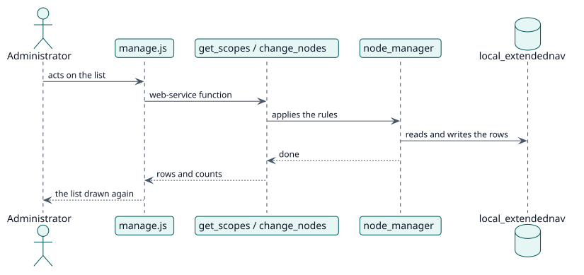

# UC-007 Change a navigation for a category, a course or an activity — design

| Overview | Requirements | Analysis | Design | Implementation | Tests |
| --- | --- | --- | --- | --- | --- |
| [Use cases](../../../requirements/use-case-overview.svg) | [Requirements](../../../requirements/use-cases/setScopeException/README.md) | [Analysis](../../../analysis/use-cases/setScopeException/README.md) | **Design** | [Implementation](../../../implementation/use-cases/setScopeException/README.md) | [Tests](../../../implementation/use-cases/setScopeException/README.md#tests) |

Analysis: [README](../../../analysis/use-cases/setScopeException/README.md)

## Elements

| Design element | Kind | Code target |
| --- | --- | --- |
| `get_scopes::execute` | service | `classes/external/get_scopes.php` |
| `repository::get_scoped_nodes` | service | `classes/local/node/repository.php` |
| `manager::ensure_row`, `set_visibility`, `save_order` | service | `classes/local/node/manager.php` |

## Sequence

## Contracts

| Operation | Input | Output | Errors |
| --- | --- | --- | --- |
| `local_extendednav_get_scopes(menu, search)` | the navigation and a part of a name | the scopes: context, name, type and changes | no capability, unknown navigation |
| `local_extendednav_delete_nodes(menu, contextid, nodekeys)` | the scope and the nodes | how many exceptions were removed | no capability, a scope that is not a category, a course or an activity |

## Data touched

| Table or entity | Operation |
| --- | --- |
| `local_extendednav` | insert (a row of the scope), update, delete (go back to the site) |
| `course`, `course_categories` | select, to find the scope |
