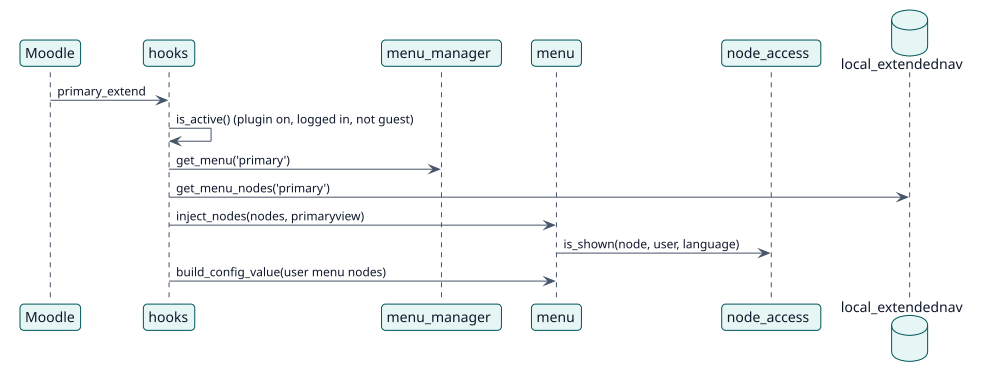

# UC-004 Show the menus of a user — design realization

| Overview | Requirements | Analysis | Design | Implementation | Tests |
| --- | --- | --- | --- | --- | --- |
| [Use cases](../../../requirements/use-case-overview.svg) | [Requirements](../../../requirements/use-cases/showMenus/README.md) | [Analysis](../../../analysis/use-cases/showMenus/README.md) | **Design** | [Implementation](../../../implementation/use-cases/showMenus/README.md) | [Tests](../../../implementation/use-cases/showMenus/README.md#tests) |

Analysis: [README](../../../analysis/use-cases/showMenus/README.md)

## Elements

| Design element | Kind | Code target |
| --- | --- | --- |
| `hooks::extend_primary_navigation` | hook | `classes/hooks.php:74` |
| `hooks::before_top_of_body` | hook | `classes/hooks.php:108` |
| `node_access::is_shown` | service | `classes/local/node_access.php:166` |

## Sequence

## Contracts

| Operation | Input | Output | Errors |
| --- | --- | --- | --- |
| `inject_nodes(nodes, primaryview)` | the nodes of the menu and the navigation view | the navigation with the nodes added | none |

## Data touched

| Table or entity | Operation |
| --- | --- |
| `local_extendednav` | read |
| `config` | read (custom menu items) |
