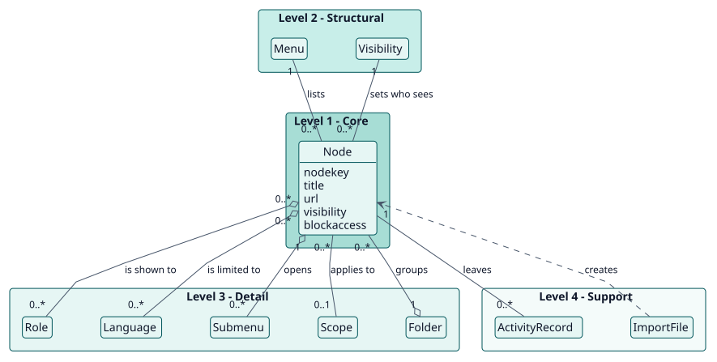
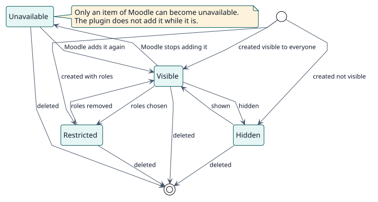

# Domain model

## Purpose

The menus of Moodle are the same for everyone and only partly configurable. Extended navigation lets an administrator shape the two menus every user sees and decide, item by item, who sees it and who may open its page. This model names the concepts behind that.

## Hierarchy of entities

The vertical position of an entity expresses its importance to the project objective. It is not UML inheritance or composition.

| Level | Meaning | Entities | Why they are here |
| --- | --- | --- | --- |
| 1 | Core: the project cannot exist without them | Node | The plugin exists to describe an item of a menu and its rules. |
| 2 | Structural: depend directly on the core | Menu, Visibility | A node belongs to a menu and has a visibility. |
| 3 | Detail: qualify or specialise level 2 | Role, Language, Submenu | They limit who sees a node and how nodes nest. |
| 4 | Support: catalogues, audit, configuration | ActivityRecord, ImportFile | They record what changed and carry navigations between sites. |

## Diagrams

## Entity dictionary

| Entity | Level | Definition | Key attributes | Omitted attributes and why |
| --- | --- | --- | --- | --- |
| Node | 1 | An item of a navigation (a menu, a secondary navigation, the page Preferences or the site administration), added by the plugin or an item of Moodle that the plugin changes. | `nodekey`, `menu`, `title`, `url`, `visibility`, `blockaccess` | The rest are in the [data model](../design/data-model/data-model.svg). |
| Menu | 2 | One of the navigations: the primary navigation, the user menu, the page Preferences, the secondary navigation of the site home, of a course and of a category, the navigation of each kind of activity, and the site administration. | `primary`, `usermenu`, `frontpage`, `course`, `category`, `mod_<module>`, `admin` | It is a class of the plugin, not a table. |
| Visibility | 2 | Who sees a node: everyone, the users with some roles, or nobody. | `visibility` | |
| Role | 3 | A role that may see a restricted node. | role shortname | It is Moodle's `role`. |
| Condition | 3 | An access restriction of Moodle on a node: a date, a group, a grouping, a profile field or a condition of a plugin. | `availability` | It is Moodle's availability tree, kept as JSON in the node. |
| Language | 3 | A language to which a node is limited. | language code | It is a list of codes in the node. |
| Submenu | 3 | The nodes shown under a parent node, one level deep. | `parentkey` | |
| Folder | 3 | A node with no URL that groups others: a submenu, a section of the preferences, a category or a tab of the site administration. | `url` empty, `parentkey` of its children | |
| Scope | 3 | The place a change applies to: the whole site, a category, a course, an activity or a user. The nearest one to a page wins. | `contextid` | It is Moodle's context. |
| ActivityRecord | 4 | An event of the log of Moodle written when a node is created, changed or deleted. | event, user, time | It is Moodle's log. |
| ImportFile | 4 | A YAML file that carries nodes between sites. | the list `nodes` | It is not stored. |

## Business rules

| ID | Rule | Entities | Source |
| --- | --- | --- | --- |
| RN-001 | A node is shown to a user when its visibility allows them and its languages include their current language; a hidden parent hides its submenu. | Node, Role, Language | `access::is_shown` |
| RN-002 | A node key is unique within its menu, and only letters, numbers, underscores and hyphens are allowed. | Node | `validator::validate` |
| RN-003 | A change that would leave every user without a landing page is refused, and Site administration can never be hidden or nested. | Node | `validator::validate` |
| RN-004 | A blocked URL sends the user to the first fallback page they may open; when none is allowed, to an explanation page. | Node | `access_guard::evaluate` |
| RN-005 | Site administrators, external URLs and the pages of administration, login and plugins are never blocked. | Node | `access_guard::is_immune` |
| RN-006 | The whole of an import file is checked before anything is saved. | ImportFile | `importer::import` |
| RN-007 | Reordering keeps a parent with its submenu, and a submenu item moves only among its siblings. | Node, Submenu | `manager::reorder` |
| RN-008 | An item of Moodle with empty fields keeps the values of Moodle. | Node | `text` |
| RN-009 | A node of a secondary navigation is found when a page shows it, once, and from then on it has a row that can be changed. | Node, Menu | `secondary::record_seen` |
| RN-010 | In the site administration every category and page, at any depth, can be renamed, hidden and ordered; a link of the plugin goes in a category; its nodes are hidden from administrators too by default. | Node, Menu | `admintree::apply` |
| RN-011 | A site administrator sees every node, unless the plugin or the node hides it from administrators too. | Node, Role | `access::is_allowed` |
| RN-012 | The nearest scope to a page wins for each node: the course, then the categories around it, then the site. | Node, Scope | `repository::get_scoped_nodes` |
| RN-013 | When a scope changes the order of any node, it sets the order of its whole navigation. | Node, Scope | `repository::get_scoped_nodes` |
| RN-014 | Deleting a node of the site deletes its exceptions. | Node, Scope | `manager::delete` |
| RN-015 | A node is shown only when its visibility, its roles and its access restrictions (Moodle's Restrict access) all let the user see it; a node of a course is checked in that course. | Node, Condition | `availability::allows` |
| RN-016 | The dates of the restrictions make a node scheduled before its start and ended after its end; it appears and disappears on its own. | Node, Condition | `availability::period` |
| RN-017 | The exceptions of a course travel in the backup of the course; the file of the site holds the nodes of the site and the exceptions of its categories. | Node, Scope | `backup_local_extendednav_plugin`, `exporter::export_file` |
| RN-018 | A category, a course or an activity changes its navigations on its own page, by whoever manages the navigation of the site or holds local/extendednav:managecontext in that context; the site administration only lists them. | Node, Scope | `context_scope::require_manage`, `node_service::require_scope` |
| RN-019 | Each kind of activity has its own navigation: a change made in it applies to every activity of that kind and to no other kind. | Menu, Node | `activity::from_key`, `injector::get_origin` |
| RN-020 | An item of the navigation of a kind of activity is listed as soon as one activity of that kind shows it, on a page or when the activities are looked through. | Menu, Node | `secondary::record_seen`, `discovery::kind` |
| RN-021 | An item that Moodle numbers is known by the path of its address, so it has the same key on every page. | Node | `secondary::key_of` |
| RN-022 | The changes of the single navigation of the activities of a version before 2.0 go to each kind that has the item; an item added goes to every kind; a change made for one activity goes to its kind only. | Menu, Node | `split_activity_navigation::execute` |
| RN-023 | What a user arranges on their page is kept as changes of their own context, applies only to them and is deleted with the user. | Node, Scope | `preferences_injector::apply` |
| RN-024 | The way to arrange the page is never hidden. | Node | `access::is_protected` |
| RN-025 | A section with no option to show is not shown; the options outside every section are a section of their own, Miscellaneous, ordered like any other. | Node, Folder | `preferences_injector::apply` |
| RN-026 | On their own page a user shows, hides, orders, renames and moves options; they never change where an option leads. | Node, Scope | `context_scope::PERSONAL` |
| RN-027 | Only the entries of the plugin older than the time kept are deleted, never the entries of another component. | ActivityRecord | `clean_activity_log::clean` |
| RN-028 | The clean-up task is on only while the clean-up is on and has a time; saving either setting turns it on or off. | ActivityRecord | `clean_activity_log::sync` |
| RN-029 | The log is read by time, a day at a time and in batches, through the index on the time. | ActivityRecord | `clean_activity_log::clean` |
| RN-030 | Whether the changes of a course go in a backup and come back with a restore is decided by two defaults of Moodle. | Node, Scope | `settings.php` |
| RN-031 | Restoring into an existing course keeps what the course already sets. | Node, Scope | `restore_local_extendednav_plugin` |
| RN-032 | A web service applies the same rules and the same capabilities as the page that does the same. | Node | `node_service::require_scope` |
| RN-033 | An import leaves out, with a warning, what names a category, a course, an activity or a user the site does not have. | ImportFile, Scope | `importer::import` |
| RN-034 | A node without a URL groups others: a submenu, a section, a category or a tab; only a group is offered as the parent of another node. | Node, Folder | `validator::validate`, `node_form` |
| RN-035 | A search or a filter of the list looks in every level of the folders. | Node, Folder | `nodes::get` |
| RN-036 | In a category, a course or an activity each kind of change has its own capability; a user holds only the ones to arrange their own page. | Scope | `context_scope::can` |

## Lifecycles

### Node

