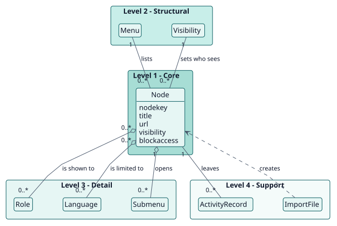
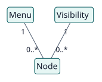
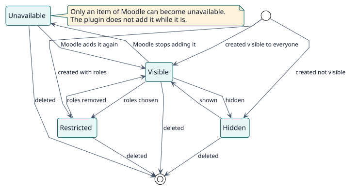

# Domain model

## Purpose

The menus of Moodle are the same for everyone and only partly configurable. Extended navigation lets an administrator shape the two menus every user sees and decide, item by item, who sees it and who may open its page. This model names the concepts behind that.

## Hierarchy of entities

The vertical position of an entity expresses its importance to the project objective. It is not UML inheritance or composition.

| Level | Meaning | Entities | Why they are here |
| --- | --- | --- | --- |
| 1 | Core: the project cannot exist without them | Node | The plugin exists to describe an item of a menu and its rules. |
| 2 | Structural: depend directly on the core | Menu, Visibility | A node belongs to a menu and has a visibility. |
| 3 | Detail: qualify or specialise level 2 | Role, Language, Submenu | They limit who sees a node and how nodes nest. |
| 4 | Support: catalogues, audit, configuration | ActivityRecord, ImportFile | They record what changed and carry navigations between sites. |

## Diagrams

## Entity dictionary

| Entity | Level | Definition | Key attributes | Omitted attributes and why |
| --- | --- | --- | --- | --- |
| Node | 1 | An item of the primary navigation or of the user menu, added by the plugin or an item of Moodle that the plugin changes. | `nodekey`, `menu`, `title`, `url`, `visibility`, `blockaccess` | The rest are in the [data model](../design/data-model/data-model.svg). |
| Menu | 2 | One of the two menus: the primary navigation or the user menu. | `primary`, `usermenu` | It is a class of the plugin, not a table. |
| Visibility | 2 | Who sees a node: everyone, the users with some roles, or nobody. | `visibility` | |
| Role | 3 | A role that may see a restricted node. | role shortname | It is Moodle's `role`. |
| Language | 3 | A language to which a node is limited. | language code | It is a list of codes in the node. |
| Submenu | 3 | The nodes shown under a parent node, one level deep. | `parentkey` | |
| ActivityRecord | 4 | An event of the log of Moodle written when a node is created, changed or deleted. | event, user, time | It is Moodle's log. |
| ImportFile | 4 | A YAML file that carries nodes between sites. | the list `nodes` | It is not stored. |

## Business rules

| ID | Rule | Entities | Source |
| --- | --- | --- | --- |
| RN-001 | A node is shown to a user when its visibility allows them and its languages include their current language; a hidden parent hides its submenu. | Node, Role, Language | `node_access::is_shown` |
| RN-002 | A node key is unique within its menu, and only letters, numbers, underscores and hyphens are allowed. | Node | `node_validator::validate` |
| RN-003 | A change that would leave every user without a landing page is refused, and Site administration can never be hidden or nested. | Node | `node_validator::validate` |
| RN-004 | A blocked URL sends the user to the first fallback page they may open; when none is allowed, to an explanation page. | Node | `access_guard::evaluate` |
| RN-005 | Site administrators, external URLs and the pages of administration, login and plugins are never blocked. | Node | `access_guard::is_immune` |
| RN-006 | The whole of an import file is checked before anything is saved. | ImportFile | `node_importer::import` |
| RN-007 | Reordering keeps a parent with its submenu, and a submenu item moves only among its siblings. | Node, Submenu | `node_manager::reorder` |
| RN-008 | An item of Moodle with empty fields keeps the values of Moodle. | Node | `node_text` |

## Lifecycles

### Node

