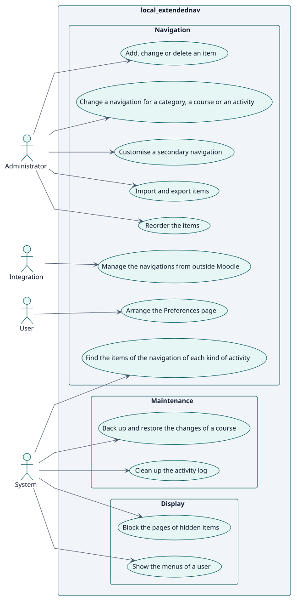
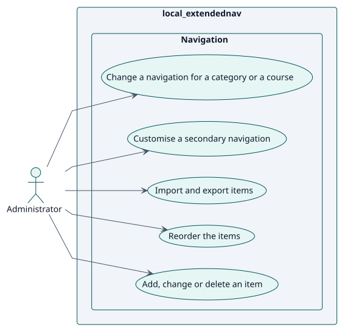
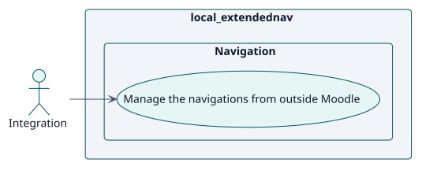
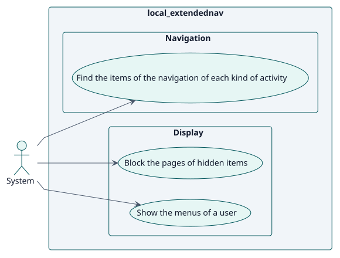
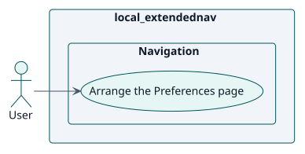

# Requirements

## Index

- [Actors](./actors.md)
- [Requirements catalogue](./requirements.md)

## Use cases

<!-- rup-flow:use-cases:start -->

| ID | Use case | Actor | Package | Requirement | Analysis | Design | Implementation |
| --- | --- | --- | --- | --- | --- | --- | --- |
| UC-001 | [Add, change or delete an item](./use-cases/manageNodes/README.md) | Administrator | Navigation | RF-001 | [card](../analysis/use-cases/manageNodes/README.md) | [card](../design/use-cases/manageNodes/README.md) | [card](../implementation/use-cases/manageNodes/README.md) |
| UC-002 | [Reorder the items](./use-cases/reorderNodes/README.md) | Administrator | Navigation | RF-002 | [card](../analysis/use-cases/reorderNodes/README.md) | [card](../design/use-cases/reorderNodes/README.md) | [card](../implementation/use-cases/reorderNodes/README.md) |
| UC-003 | [Import and export items](./use-cases/importNodes/README.md) | Administrator | Navigation | RF-003 | [card](../analysis/use-cases/importNodes/README.md) | [card](../design/use-cases/importNodes/README.md) | [card](../implementation/use-cases/importNodes/README.md) |
| UC-004 | [Show the menus of a user](./use-cases/showMenus/README.md) | System | Display | RF-004 | [card](../analysis/use-cases/showMenus/README.md) | [card](../design/use-cases/showMenus/README.md) | [card](../implementation/use-cases/showMenus/README.md) |
| UC-005 | [Block the pages of hidden items](./use-cases/blockUrl/README.md) | System | Display | RF-005 | [card](../analysis/use-cases/blockUrl/README.md) | [card](../design/use-cases/blockUrl/README.md) | [card](../implementation/use-cases/blockUrl/README.md) |
| UC-006 | [Customise a secondary navigation](./use-cases/customiseSecondaryNavigation/README.md) | Administrator | Navigation | RF-007 | [card](../analysis/use-cases/customiseSecondaryNavigation/README.md) | [card](../design/use-cases/customiseSecondaryNavigation/README.md) | [card](../implementation/use-cases/customiseSecondaryNavigation/README.md) |
| UC-007 | [Change a navigation for a category, a course or an activity](./use-cases/setScopeException/README.md) | Administrator | Navigation | RF-008 | [card](../analysis/use-cases/setScopeException/README.md) | [card](../design/use-cases/setScopeException/README.md) | [card](../implementation/use-cases/setScopeException/README.md) |
| UC-008 | [Find the items of the navigation of each kind of activity](./use-cases/discoverActivityItems/README.md) | System | Navigation | RF-012 | [card](../analysis/use-cases/discoverActivityItems/README.md) | [card](../design/use-cases/discoverActivityItems/README.md) | [card](../implementation/use-cases/discoverActivityItems/README.md) |
| UC-009 | [Arrange the Preferences page](./use-cases/arrangePreferences/README.md) | User | Navigation | RF-015 | [card](../analysis/use-cases/arrangePreferences/README.md) | [card](../design/use-cases/arrangePreferences/README.md) | [card](../implementation/use-cases/arrangePreferences/README.md) |
| UC-010 | [Clean up the activity log](./use-cases/cleanActivityLog/README.md) | System | Maintenance | RF-016 | [card](../analysis/use-cases/cleanActivityLog/README.md) | [card](../design/use-cases/cleanActivityLog/README.md) | [card](../implementation/use-cases/cleanActivityLog/README.md) |
| UC-011 | [Back up and restore the changes of a course](./use-cases/backUpChanges/README.md) | System | Maintenance | RF-017 | [card](../analysis/use-cases/backUpChanges/README.md) | [card](../design/use-cases/backUpChanges/README.md) | [card](../implementation/use-cases/backUpChanges/README.md) |
| UC-012 | [Manage the navigations from outside Moodle](./use-cases/manageByWebService/README.md) | Integration | Navigation | RF-018 | [card](../analysis/use-cases/manageByWebService/README.md) | [card](../design/use-cases/manageByWebService/README.md) | [card](../implementation/use-cases/manageByWebService/README.md) |

### Use-case diagram

### By actor

#### Administrator

#### Integration

#### System

#### User

<!-- rup-flow:use-cases:end -->

The index and its diagrams are generated from the use-case cards by the `index` command. Edit the cards (front matter: `actor`, `package`, `includes`, `extends`), not this block.

## Conventions

- `specification.puml` is the behavioural source of truth of a use case: a statechart with the Actor/System conversation.
- `wireframes.puml` is the interface prototype, even when it holds a single screen.
- Each use-case folder holds `README.md`, `specification.puml` and `wireframes.puml`.
