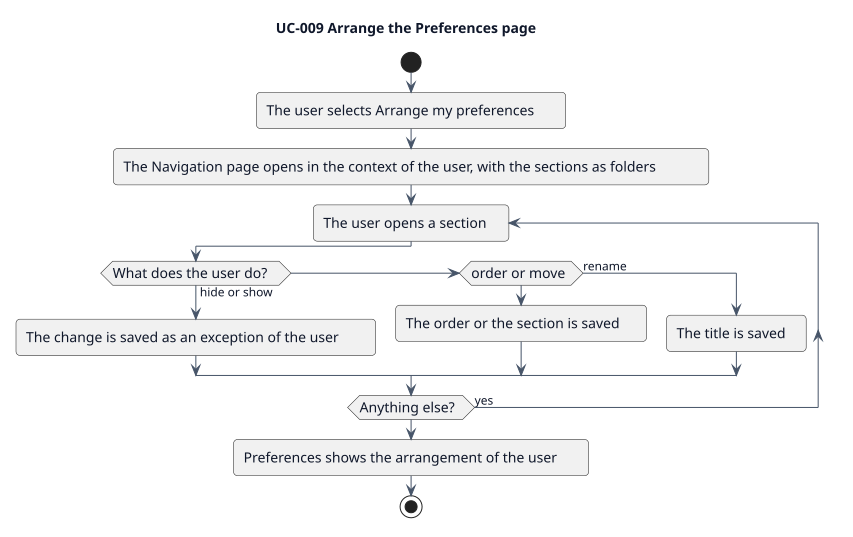
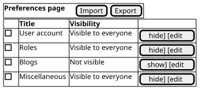

# UC-009 Arrange the Preferences page

| Overview | Requirements | Analysis | Design | Implementation | Tests |
| --- | --- | --- | --- | --- | --- |
| [Use cases](../../../requirements/use-case-overview.svg) | **Requirements** | [Analysis](../../../analysis/use-cases/arrangePreferences/README.md) | [Design](../../../design/use-cases/arrangePreferences/README.md) | [Implementation](../../../implementation/use-cases/arrangePreferences/README.md) | [Tests](../../../implementation/use-cases/arrangePreferences/README.md#tests) |

## Use-case information

| Field | Value |
| --- | --- |
| Actor | User; an administrator, for the page of another user |
| Package | Navigation |
| Goal | Hide, order, rename and move the sections and options of the page Preferences, for the whole site or for one user. |
| Type | Primary, real |
| Level | User goal |
| Requirement | RF-015 |
| Domain entities | Menu, Node, Scope |

## Context

The page Preferences of Moodle shows sections (User account, Badges, Blogs...) that hold options (Edit profile, Change password...). Moodle has no list of them: they depend on the user and on the plugins installed. The plugin records the sections and options it sees and lists them as folders, as the site administration is listed. The site arranges them for everyone from the management page; each user arranges their own page in the same list, opened on their own context, and an administrator arranges the page of any user from the Preferences of that user.

## Preconditions

- The plugin and the navigation of the preferences are on.
- The person holds local/extendednav:personalise (every user has it by default), or manages the navigation of the site.

## Postconditions

- Success: The page Preferences of that user shows the sections and options as arranged; whatever is not changed follows the site.
- Failure: The page is left as it was.

## Main flow

| Step | Actor | System |
| --- | --- | --- |
| 1 | The user opens Preferences and selects **Arrange my preferences**, in the section Extended navigation. |  |
| 2 |  | Opens the Navigation page in the context of the user, which lists the sections as folders. |
| 3 | The user selects the name of a section. | Lists the options of the section. |
| 4 | The user hides an option with its eye button, or shows it again. | Saves the change as an exception of the context of the user and draws the list again. |
| 5 | The user drags a row to change its place, or edits an option to choose another section or to rename it. | Saves the order, the section or the name. |
| 6 | The user opens Preferences again. | Draws the page with the arrangement of the user. |

## Alternative flows

| ID | Starts at step | Condition | Behaviour | Ends |
| --- | --- | --- | --- | --- |
| A1 | 1 | An administrator opens the Preferences of another user. | The section Extended navigation offers **Arrange the preferences of** that user, and the same flow changes that user's page. | Step 6 |
| A2 | 4 | The person may not make that kind of change. | The button is not shown, and the service refuses the change. | Step 4 |
| A3 | 4 | The option is the way to arrange the page. | It cannot be hidden. | Step 4 |
| A4 | 5 | The user deletes a change. | The option follows the site again. | Step 6 |
| A5 | 1 | The person lacks local/extendednav:personalise. | The section Extended navigation is not offered and the page follows the site. | Step 6 |

## Business rules

| ID | Rule |
| --- | --- |
| RN-023 | What a user arranges on their page is kept as changes of their own context, applies only to them and is deleted with the user. |
| RN-024 | The way to arrange the page is never hidden. |
| RN-025 | A section with no option to show is not shown; the options outside every section are a section of their own, Miscellaneous, ordered like any other. |
| RN-026 | On their own page a user shows, hides, orders, renames and moves options; they never change where an option leads. |

## Specification

Behaviour source of truth: [specification.puml](./specification.puml)

## Wireframes

