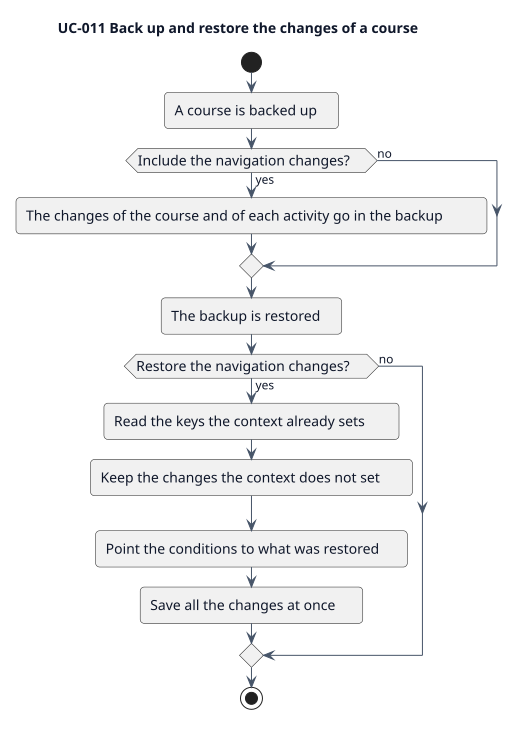

# UC-011 Back up and restore the changes of a course

| Overview | Requirements | Analysis | Design | Implementation | Tests |
| --- | --- | --- | --- | --- | --- |
| [Use cases](../../../requirements/use-case-overview.svg) | **Requirements** | [Analysis](../../../analysis/use-cases/backUpChanges/README.md) | [Design](../../../design/use-cases/backUpChanges/README.md) | [Implementation](../../../implementation/use-cases/backUpChanges/README.md) | [Tests](../../../implementation/use-cases/backUpChanges/README.md#tests) |

## Use-case information

| Field | Value |
| --- | --- |
| Actor | System (the backup and restore of Moodle) |
| Package | Maintenance |
| Goal | Carry the changes a course and its activities make to their navigations in the backups of Moodle, as the site decides. |
| Type | Secondary, essential |
| Level | Subfunction |
| Requirement | RF-017 |
| Domain entities | Node, Scope |

## Context

A course and each of its activities can change their navigations. Those changes belong to the course, so they travel in its backup and come back with its restore, not in the file of the site. The site decides, among the defaults of Moodle for backups and for restores, whether they are included.

## Preconditions

- The course or the activity has changes of its own, or the backup holds them.

## Postconditions

- Success: The backup holds the changes of the course and its activities; the restore creates them for the course restored, with their conditions pointing to what was restored.
- Failure: A change the context restored already sets is left as it is.

## Main flow

| Step | Actor | System |
| --- | --- | --- |
| 1 | An administrator or a teacher backs up a course. | Adds the changes of the course and of each activity to the backup, when **Include the navigation changes** is on in the defaults of the backups. |
| 2 | Someone restores the backup, into a new or an existing course. | Reads the changes, unless **Restore the navigation changes** is off in the defaults of the restores. |
| 3 |  | Reads once the changes the context restored already sets. |
| 4 |  | Keeps, for each navigation and key, the change of the backup only when the context does not set it. |
| 5 |  | When the course and its activities are restored, points the conditions on grades, activities, groups and groupings to the ones restored, and moves the dates as the course is moved. |
| 6 |  | Saves all the changes at once. |

## Alternative flows

| ID | Starts at step | Condition | Behaviour | Ends |
| --- | --- | --- | --- | --- |
| A1 | 1 | The default of the backups is off. | The backup holds no change. | Step 2 |
| A2 | 2 | The default of the restores is off. | The changes of the backup are left out. | Step 6 |
| A3 | 2 | The backup is one of a version before each kind of activity had its own navigation. | The changes of the single navigation of the activities go to the kind of the activity restored or, for a course, to each kind that has the item. | Step 6 |

## Business rules

| ID | Rule |
| --- | --- |
| RN-017 | The exceptions of a course travel in the backup of the course; the file of the site holds the nodes of the site and the exceptions of its categories. |
| RN-030 | Whether the changes go in a backup and come back with a restore is decided by two defaults of Moodle, one for backups and one for restores. |
| RN-031 | Restoring into an existing course keeps what the course already sets. |

## Specification

Behaviour source of truth: [specification.puml](./specification.puml)

## Wireframes

