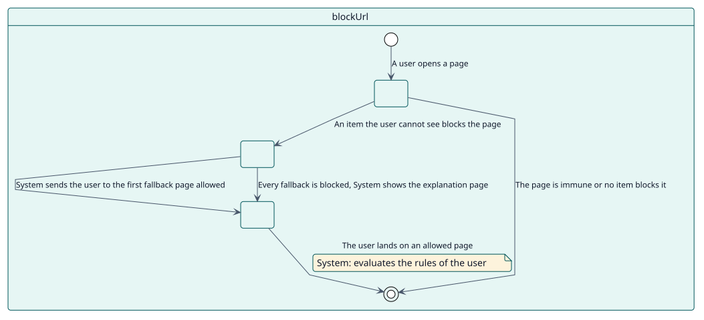
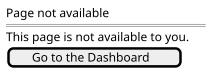

# UC-005 Block the pages of hidden items

| Overview | Requirements | Analysis | Design | Implementation | Tests |
| --- | --- | --- | --- | --- | --- |
| [Use cases](../../use-case-overview.svg) | **Requirements** | [Analysis](../../../analysis/use-cases/blockUrl/README.md) | [Design](../../../design/use-cases/blockUrl/README.md) | [Implementation](../../../implementation/use-cases/blockUrl/README.md) | [Tests](../../../implementation/use-cases/blockUrl/README.md#tests) |

## Use-case information

| Field | Value |
| --- | --- |
| Actor | System |
| Package | Display |
| Goal | Keep users from opening the pages of the items they cannot see. |
| Type | Primary, essential |
| Level | User goal |
| Requirement | RF-005 |
| Domain entities | Node, Visibility, Role |

## Context

Hiding an item from a menu does not keep a user from typing its address. With blocking on, the plugin stops that on each page and sends the user somewhere they may be.

## Preconditions

- The plugin is enabled.
- At least one node has **Block URL access**.

## Postconditions

- Success: a user who opens a blocked page is sent to the first fallback page that they may open.
- Failure: a page that nothing blocks is shown as usual.

## Main flow

| Step | Actor | System |
| --- | --- | --- |
| 1 |  | Receives the hook that runs before the headers of each page. |
| 2 |  | Takes the site path of the page and checks that it is not immune. |
| 3 |  | Reads the nodes and works out which of them block the page for this user. |
| 4 |  | Sends the user to the first of the Dashboard, the Site home, My courses and the default home page that is allowed. |

## Alternative flows

| ID | Starts at step | Condition | Behaviour | Ends |
| --- | --- | --- | --- | --- |
| A1 | 2 | The page is external, an administration, login or plugin page, or the user is a site administrator. | Lets it through. | End |
| A2 | 3 | An item that the user can see opens the same URL. | Lets it through. | End |
| A3 | 4 | Every fallback page is blocked. | Shows a page that explains it. | End |

## Business rules

| ID | Rule |
| --- | --- |
| RN-004 | A blocked URL sends the user to the first fallback they may open. |
| RN-005 | Administrators, external URLs and the pages of administration, login and plugins are never blocked. |

## Specification

Behaviour source of truth: [specification.puml](./specification.puml)

## Wireframes

