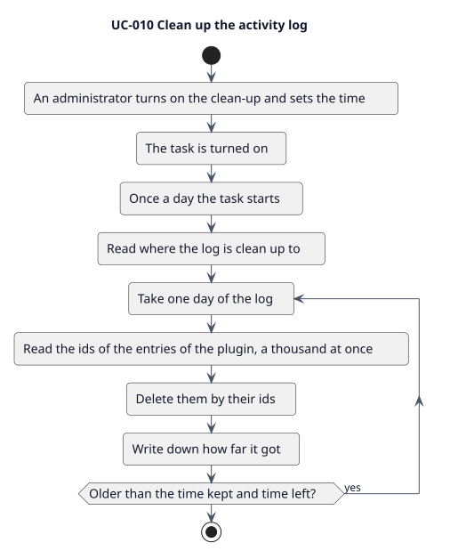
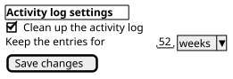

# UC-010 Clean up the activity log

| Overview | Requirements | Analysis | Design | Implementation | Tests |
| --- | --- | --- | --- | --- | --- |
| [Use cases](../../../requirements/use-case-overview.svg) | **Requirements** | [Analysis](../../../analysis/use-cases/cleanActivityLog/README.md) | [Design](../../../design/use-cases/cleanActivityLog/README.md) | [Implementation](../../../implementation/use-cases/cleanActivityLog/README.md) | [Tests](../../../implementation/use-cases/cleanActivityLog/README.md#tests) |

## Use-case information

| Field | Value |
| --- | --- |
| Actor | System (the scheduled task); an administrator turns it on |
| Package | Maintenance |
| Goal | Delete the entries of the activity log of the navigation that are older than the time the site keeps them. |
| Type | Secondary, essential |
| Level | Subfunction |
| Requirement | RF-016 |
| Domain entities | ActivityRecord |

## Context

The changes to the navigation are written in the standard log of Moodle. On a site with many changes the log grows without limit. The site can keep the entries for a time, and a scheduled task deletes the older ones. The clean-up is off by default, and the task is on only while the clean-up is.

## Preconditions

- The standard log of Moodle is on.
- An administrator turned the clean-up on and set how long the entries are kept.

## Postconditions

- Success: The entries of the plugin older than the time kept are deleted; the others, and every entry of another component, are as they were.
- Failure: Nothing is deleted; the next run goes on from where this one stopped.

## Main flow

| Step | Actor | System |
| --- | --- | --- |
| 1 | An administrator turns on **Clean up the activity log** and sets **Keep the entries for**, in Reports > Extended navigation > Activity log settings. | Saves the settings and turns the scheduled task on. |
| 2 |  | Runs the task once a day, at a random time. |
| 3 |  | Reads the time up to which the log is clean; the first time, the time of the oldest entry. |
| 4 |  | Takes one day of the log at a time and reads, through the index on the time, the ids of the entries of the plugin, a thousand at once. |
| 5 |  | Deletes those entries by their ids and goes on to the next batch and the next day, up to the time kept. |
| 6 |  | Writes down how far it got and stops when it reaches the time kept or when its time is spent. |

## Alternative flows

| ID | Starts at step | Condition | Behaviour | Ends |
| --- | --- | --- | --- | --- |
| A1 | 1 | An administrator turns the clean-up off, or sets no time. | The task is turned off and deletes nothing. | Step 1 |
| A2 | 6 | The time of the run is spent. | The rest waits for the next run, which resumes from the time written down. | Step 6 |
| A3 | 4 | The log has no entries. | Nothing is read or deleted. | Step 6 |

## Business rules

| ID | Rule |
| --- | --- |
| RN-027 | Only the entries of the plugin older than the time kept are deleted, never the entries of another component. |
| RN-028 | The task is on only while the clean-up is on and has a time; saving either setting turns it on or off. |
| RN-029 | The log is read by time, a day at a time and in batches, through the index on the time, never the whole table at once. |

## Specification

Behaviour source of truth: [specification.puml](./specification.puml)

## Wireframes

