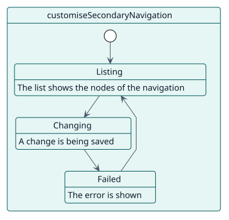
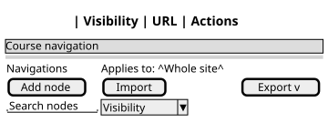

# UC-006 Customise a secondary navigation

| Overview | Requirements | Analysis | Design | Implementation | Tests |
| --- | --- | --- | --- | --- | --- |
| [Use cases](../../use-case-overview.svg) | **Requirements** | [Analysis](../../../analysis/use-cases/customiseSecondaryNavigation/README.md) | [Design](../../../design/use-cases/customiseSecondaryNavigation/README.md) | [Implementation](../../../implementation/use-cases/customiseSecondaryNavigation/README.md) | [Tests](../../../implementation/use-cases/customiseSecondaryNavigation/README.md#tests) |

## Use-case information

| Field | Value |
| --- | --- |
| Actor | Administrator |
| Package | Navigation |
| Goal | Order, rename, hide and extend the navigation of a course, an activity, a category or the site administration. |
| Type | Primary, essential |
| Level | User goal |
| Requirement | RF-007 |
| Domain entities | Node, Menu, Visibility, Role, Language |

## Context

The navigations that Moodle draws under the header of a page depend on the page, on who looks and on the plugins. An administrator orders them, renames or hides their nodes, decides which go in the More menu and adds nodes of their own, for the whole site.

## Preconditions

- The administrator holds `local/extendednav:manage`, or is a site administrator.
- The plugin is enabled.

## Postconditions

- Success: the change is saved and the navigation of the next page shows it.
- Failure: the node keeps its values and the page shows the error.

## Main flow

| Step | Actor | System |
| --- | --- | --- |
| 1 | Chooses a navigation in the column of the management page. | Lists the nodes that pages have shown in that navigation. |
| 2 | Hides, shows or moves a node, or selects several and acts on them. | Saves the change through a web-service function and draws the list again without reloading the page. |
| 3 | Edits a node: title, link, roles, languages, where it goes, hidden from administrators. | Validates the node with the rules of the plugin and saves it. |
| 4 | Adds a node of their own. | Adds it to the navigation after the nodes of Moodle. |

## Alternative flows

| ID | Starts at step | Condition | Behaviour | Ends |
| --- | --- | --- | --- | --- |
| A1 | 1 | The navigation has no nodes yet. | The list explains that Moodle's nodes appear when a page shows them, and offers to add a node. | Step 1 |
| A2 | 2 | The navigation is the site administration. | The list shows one level of the tree; the top level groups the items of the General tab of Moodle under General. | Step 2 |
| A3 | 2 | The server refuses the change. | Shows the error and keeps the list as it was. | Step 1 |

## Business rules

| ID | Rule |
| --- | --- |
| RN-009 | A node of a secondary navigation is found when a page shows it, once, and from then on it has a row that can be changed. |
| RN-010 | In the site administration every category and page, at any depth, can be renamed, hidden and ordered; a link of the plugin goes in a category; its nodes are hidden from administrators too by default. |
| RN-011 | A site administrator sees every node, unless the plugin or the node hides it from administrators too. |

## Specification

Behaviour source of truth: [specification.puml](./specification.puml)

## Wireframes

