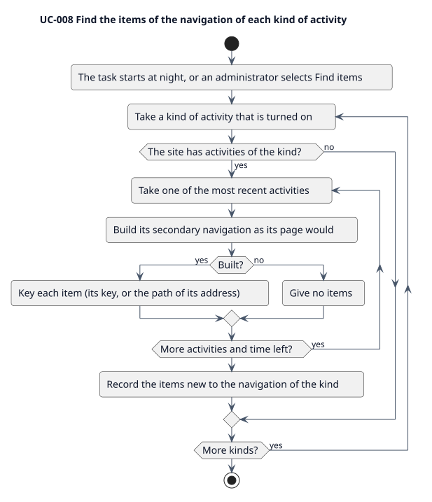

# UC-008 Find the items of the navigation of each kind of activity

| Overview | Requirements | Analysis | Design | Implementation | Tests |
| --- | --- | --- | --- | --- | --- |
| [Use cases](../../../requirements/use-case-overview.svg) | **Requirements** | [Analysis](../../../analysis/use-cases/discoverActivityItems/README.md) | [Design](../../../design/use-cases/discoverActivityItems/README.md) | [Implementation](../../../implementation/use-cases/discoverActivityItems/README.md) | [Tests](../../../implementation/use-cases/discoverActivityItems/README.md#tests) |

## Use-case information

| Field | Value |
| --- | --- |
| Actor | System (the scheduled task); an administrator from the list of a kind of activity |
| Package | Navigation |
| Goal | List the items Moodle and its plugins add to the navigation of each kind of activity, so they can be changed before anyone opens such an activity. |
| Type | Secondary, essential |
| Level | Subfunction |
| Requirement | RF-012 |
| Domain entities | Menu, Node |

## Context

Moodle has no list of the items of the navigation of an activity: they depend on the kind of activity, on the plugins installed and, for some plugins, on how each activity is set up. A report that a plugin adds only to the assignments that use it appears in those assignments alone. The pages record what they show, but an item nobody has opened yet cannot be changed. This use case builds the navigation of the activities of the site, as their pages would, and lists what it finds.

## Preconditions

- The plugin is on.
- The kind of activity is turned on in the site.

## Postconditions

- Success: every item found in an activity of the kind is in the list of its navigation, with its text and its address, and has a row that can be changed.
- Failure: an activity whose navigation cannot be built gives no items; the others are still looked through.

## Main flow

| Step | Actor | System |
| --- | --- | --- |
| 1 | The scheduled task starts, once a day, as an administrator. | |
| 2 | | Takes each kind of activity that is turned on. |
| 3 | | Takes the most recent activities of the kind, up to 50. |
| 4 | | Builds the secondary navigation of each activity, with the page of the activity as the page being built. |
| 5 | | Gives each item its key: the key Moodle gives it or, for an item Moodle numbers, the path of its address. |
| 6 | | Records the items new to the navigation of the kind and gives each a row. |

## Alternative flows

| ID | Starts at step | Condition | Behaviour | Ends |
| --- | --- | --- | --- | --- |
| A1 | 1 | An administrator selects **Find items** on the list of a kind of activity. | The same flow runs for that kind only, with the 30 most recent activities and 8 seconds at most, and the list is drawn again with the number of activities reviewed and of items found. | Step 6 |
| A2 | 3 | The kind has no activity on the site. | Nothing is looked through; the page says that the site has no activity of the kind. | Step 3 |
| A3 | 4 | The navigation of an activity cannot be built. | The activity gives no items and the next one is taken. | Step 4 |
| A4 | 4 | The time of the task is spent. | The remaining activities wait for the next run. | Step 6 |

## Business rules

| ID | Rule |
| --- | --- |
| RN-019 | Each kind of activity has its own navigation. |
| RN-020 | An item is listed as soon as one activity of its kind shows it. |
| RN-021 | An item that Moodle numbers is known by the path of its address. |

## Specification

Behaviour source of truth: [specification.puml](./specification.puml)

## Wireframes

