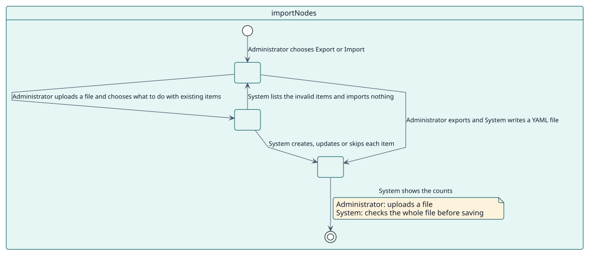
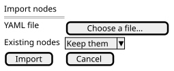

# UC-003 Import and export items

| Overview | Requirements | Analysis | Design | Implementation | Tests |
| --- | --- | --- | --- | --- | --- |
| [Use cases](../../use-case-overview.svg) | **Requirements** | [Analysis](../../../analysis/use-cases/importNodes/README.md) | [Design](../../../design/use-cases/importNodes/README.md) | [Implementation](../../../implementation/use-cases/importNodes/README.md) | [Tests](../../../implementation/use-cases/importNodes/README.md#tests) |

## Use-case information

| Field | Value |
| --- | --- |
| Actor | Administrator |
| Package | Navigation |
| Goal | Copy the navigation from one site to another. |
| Type | Primary, essential |
| Level | User goal |
| Requirement | RF-003 |
| Domain entities | ImportFile, Node |

## Context

A navigation takes work to build. An administrator exports its items to a YAML file and imports it in another site; the whole file is checked before anything is saved.

## Preconditions

- The administrator holds `local/extendednav:manage`.

## Postconditions

- Success: the file is written, or the items are created, updated or skipped and the counts are shown.
- Failure: an invalid file imports nothing and every error is listed.

## Main flow

| Step | Actor | System |
| --- | --- | --- |
| 1 | Chooses **Export all**, or selects items and **Export selected**. | Writes a YAML file with each item and its position. |
| 2 | Chooses **Import**, uploads a file and chooses what to do with the existing items. | Reads the file and validates every item. |
| 3 |  | Creates, updates or skips each item, keeping its position. |
| 4 |  | Shows the counts and the warnings, such as a language that is not installed. |

## Alternative flows

| ID | Starts at step | Condition | Behaviour | Ends |
| --- | --- | --- | --- | --- |
| A1 | 2 | An item is not valid. | Lists each invalid item with the reason and imports nothing. | Step 2 |
| A2 | 2 | The file has no `nodes` list. | Refuses the file. | Step 2 |

## Business rules

| ID | Rule |
| --- | --- |
| RN-006 | The whole file is checked before anything is saved. |

## Specification

Behaviour source of truth: [specification.puml](./specification.puml)

## Wireframes

