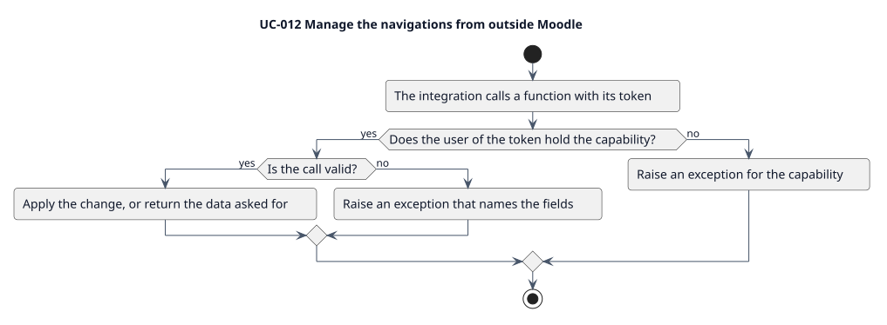

# UC-012 Manage the navigations from outside Moodle

| Overview | Requirements | Analysis | Design | Implementation | Tests |
| --- | --- | --- | --- | --- | --- |
| [Use cases](../../../requirements/use-case-overview.svg) | **Requirements** | [Analysis](../../../analysis/use-cases/manageByWebService/README.md) | [Design](../../../design/use-cases/manageByWebService/README.md) | [Implementation](../../../implementation/use-cases/manageByWebService/README.md) | [Tests](../../../implementation/use-cases/manageByWebService/README.md#tests) |

## Use-case information

| Field | Value |
| --- | --- |
| Actor | Integration (a system outside Moodle with a token) |
| Package | Navigation |
| Goal | Read, change, export and import the navigations through the web services of the plugin. |
| Type | Primary, real |
| Level | User goal |
| Requirement | RF-018 |
| Domain entities | Menu, Node, Scope |

## Context

Everything the management page does is done with web services, so a system outside Moodle can do it too: list the navigations and their nodes, add and change a node, show, hide, order and delete nodes, turn a navigation on or off, and move whole navigations in and out of a file. The functions are gathered in the service Extended navigation, which an administrator turns on and gives a token.

## Preconditions

- The service Extended navigation is on and the integration has a token of a user that holds the capabilities the functions need.

## Postconditions

- Success: The change is made, as it would be from the management page, or the data asked for is returned.
- Failure: The function raises an exception and nothing is saved.

## Main flow

| Step | Actor | System |
| --- | --- | --- |
| 1 | The integration calls `local_extendednav_get_navigations`. | Returns every navigation with its key, name, whether it is on, whether it is a folder tree and whether contexts change it. |
| 2 | The integration calls `local_extendednav_get_nodes` for a navigation and a context. | Checks the capability and returns a page of the nodes. |
| 3 | The integration calls `local_extendednav_save_node` with the key of a node and the fields to set. | Checks the capabilities and the fields the context allows, validates the node with the rules of the form and saves it. |
| 4 | The integration calls `local_extendednav_set_visibility`, `local_extendednav_reorder_nodes` or `local_extendednav_delete_nodes`. | Applies the change with the capability of that kind of change. |
| 5 | The integration calls `local_extendednav_export_navigations` with the navigations and the contexts wanted. | Returns the file in YAML. |
| 6 | The integration calls `local_extendednav_import_navigations` with a file. | Checks the whole file and saves it, leaving out with a warning the contexts the site does not have. |

## Alternative flows

| ID | Starts at step | Condition | Behaviour | Ends |
| --- | --- | --- | --- | --- |
| A1 | 2 | The user of the token lacks the capability. | The function raises an exception for the capability. | Step 2 |
| A2 | 3 | A field is not valid, or the context does not allow it. | The function raises an exception that names the fields and saves nothing. | Step 3 |
| A3 | 6 | A node of the file names a category, a course, an activity or a user that does not exist. | It is left out and the result carries a warning for it; the rest is imported. | Step 6 |
| A4 | 6 | A node of the file is not valid. | Nothing is saved and the result lists the errors. | Step 6 |

## Business rules

| ID | Rule |
| --- | --- |
| RN-032 | A web service applies the same rules and the same capabilities as the page that does the same. |
| RN-033 | An import leaves out, with a warning, what names a category, a course, an activity or a user the site does not have. |

## Specification

Behaviour source of truth: [specification.puml](./specification.puml)

## Wireframes

