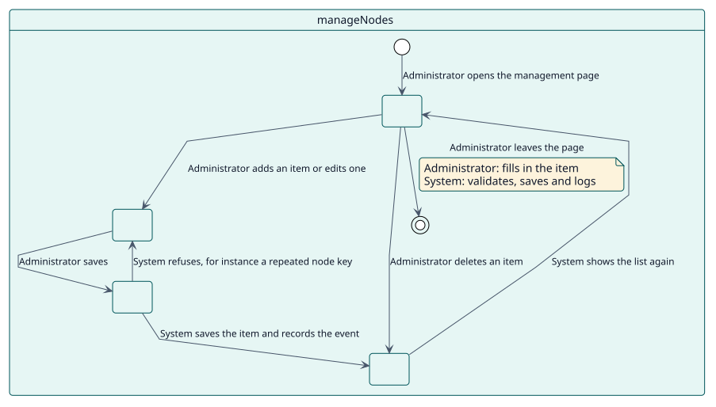
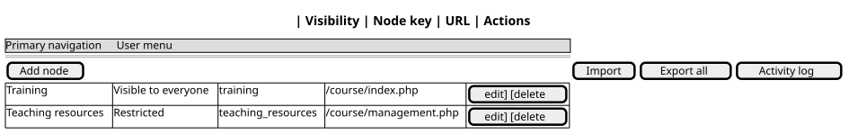

# UC-001 Add, change or delete an item

| Overview | Requirements | Analysis | Design | Implementation | Tests |
| --- | --- | --- | --- | --- | --- |
| [Use cases](../../use-case-overview.svg) | **Requirements** | [Analysis](../../../analysis/use-cases/manageNodes/README.md) | [Design](../../../design/use-cases/manageNodes/README.md) | [Implementation](../../../implementation/use-cases/manageNodes/README.md) | [Tests](../../../implementation/use-cases/manageNodes/README.md#tests) |

## Use-case information

| Field | Value |
| --- | --- |
| Actor | Administrator |
| Package | Navigation |
| Goal | Shape the primary navigation and the user menu item by item. |
| Type | Primary, essential |
| Level | User goal |
| Requirement | RF-001 |
| Domain entities | Node, Menu, Visibility, Role, Language, ActivityRecord |

## Context

An administrator adds items to a menu, changes the items of Moodle or removes items, and decides who sees each one and whether its page is blocked.

## Preconditions

- The administrator holds `local/extendednav:manage`, or is a site administrator.

## Postconditions

- Success: the item is saved, the menu shows it at once and the change is logged.
- Failure: nothing is saved and the form shows what to fix.

## Main flow

| Step | Actor | System |
| --- | --- | --- |
| 1 | Opens the management page and chooses **Add node**, or the edit icon of an item. | Shows the form, with the values of Moodle as placeholders for its items. |
| 2 | Fills in the key, title, URL, icon, visibility, roles, languages and parent, and saves. | Validates the item against the others of its menu. |
| 3 |  | Saves it in `local_extendednav` and triggers `node_created` or `node_updated`. |
| 4 | Deletes an item. | Deletes it and triggers `node_deleted`. |

## Alternative flows

| ID | Starts at step | Condition | Behaviour | Ends |
| --- | --- | --- | --- | --- |
| A1 | 2 | The key is repeated or not valid, or the URL or the title is missing. | Shows the error under the field; nothing is saved. | Step 1 |
| A2 | 2 | The change would leave every user without a landing page. | Refuses it. | Step 1 |
| A3 | 2 | The item is Site administration and is hidden or nested. | Refuses it. | Step 1 |

## Business rules

| ID | Rule |
| --- | --- |
| RN-002 | A node key is unique within its menu. |
| RN-003 | A change that would leave every user without a landing page is refused. |
| RN-008 | An item of Moodle with empty fields keeps the values of Moodle. |

## Specification

Behaviour source of truth: [specification.puml](./specification.puml)

## Wireframes

