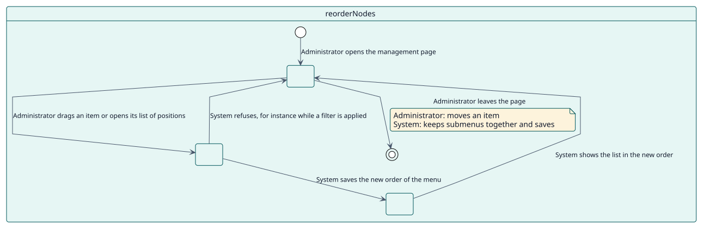
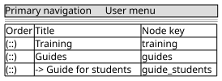

# UC-002 Reorder the items

| Overview | Requirements | Analysis | Design | Implementation | Tests |
| --- | --- | --- | --- | --- | --- |
| [Use cases](../../use-case-overview.svg) | **Requirements** | [Analysis](../../../analysis/use-cases/reorderNodes/README.md) | [Design](../../../design/use-cases/reorderNodes/README.md) | [Implementation](../../../implementation/use-cases/reorderNodes/README.md) | [Tests](../../../implementation/use-cases/reorderNodes/README.md#tests) |

## Use-case information

| Field | Value |
| --- | --- |
| Actor | Administrator |
| Package | Navigation |
| Goal | Change the position of the items of a menu. |
| Type | Primary, essential |
| Level | User goal |
| Requirement | RF-002 |
| Domain entities | Node, Menu, Submenu |

## Context

The order of the list is the order of the menu. An administrator drags an item, or chooses a position with the keyboard, and the submenus stay together.

## Preconditions

- The administrator holds `local/extendednav:manage`.
- No filter is applied.

## Postconditions

- Success: the new order is saved and the menu shows it.
- Failure: the order does not change.

## Main flow

| Step | Actor | System |
| --- | --- | --- |
| 1 | Drags an item by its handle, or opens its list of positions. | Computes the new order of the menu. |
| 2 | Drops it. | Saves the order through the web-service function. |
| 3 |  | Keeps a parent with its submenu items. |

## Alternative flows

| ID | Starts at step | Condition | Behaviour | Ends |
| --- | --- | --- | --- | --- |
| A1 | 1 | A filter is applied. | Ordering is off. | Step 1 |
| A2 | 2 | The server refuses the order. | Shows the error and keeps the list as it was. | Step 1 |

## Business rules

| ID | Rule |
| --- | --- |
| RN-007 | A parent moves with its submenu; a submenu item moves only among its siblings. |

## Specification

Behaviour source of truth: [specification.puml](./specification.puml)

## Wireframes

