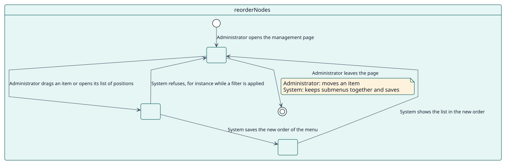
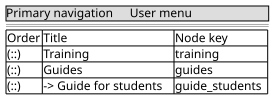

# UC-002 Reorder the items

| Overview | Requirements | Analysis | Design | Implementation | Tests |
| --- | --- | --- | --- | --- | --- |
| [Use cases](../../use-case-overview.svg) | **Requirements** | [Analysis](../../../analysis/use-cases/reorderNodes/README.md) | [Design](../../../design/use-cases/reorderNodes/README.md) | [Implementation](../../../implementation/use-cases/reorderNodes/README.md) | [Tests](../../../implementation/use-cases/reorderNodes/README.md#tests) |

## Use-case information

| Field | Value |
| --- | --- |
| Actor | Administrator |
| Package | Navigation |
| Goal | Change the position of the items of a menu. |
| Type | Primary, essential |
| Level | User goal |
| Requirement | RF-002 |
| Domain entities | Node, Menu, Submenu |

## Context

The order of the list is the order of the menu. The list shows every item, without pages. An administrator drags an item by its handle, alone or with the items selected among its siblings, or moves it with the arrow keys on its handle; the submenus stay together.

## Preconditions

- The administrator holds `local/extendednav:manage`.
- No filter is applied.

## Postconditions

- Success: the new order is saved and the menu shows it.
- Failure: the order does not change.

## Main flow

| Step | Actor | System |
| --- | --- | --- |
| 1 | Drags an item by its handle and drops it over or under a sibling. | Takes with it the items selected among its siblings, in their order, and computes the new order. |
| 2 |  | Saves the order through the web-service function. |
| 3 |  | Keeps a parent with its submenu items, and draws the list again. |

## Alternative flows

| ID | Starts at step | Condition | Behaviour | Ends |
| --- | --- | --- | --- | --- |
| A1 | 1 | A search or a filter is applied, or the screen is narrower than 768 px. | The handles are not shown. | Step 1 |
| A2 | 2 | The server refuses the order. | Shows the error and keeps the list as it was. | Step 1 |
| A3 | 1 | The administrator presses the up or down arrow key on the handle. | Moves the item one place among its siblings. | Step 2 |

## Business rules

| ID | Rule |
| --- | --- |
| RN-007 | A parent moves with its submenu; a submenu item moves only among its siblings. |

## Specification

Behaviour source of truth: [specification.puml](./specification.puml)

## Wireframes

