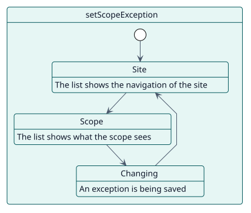
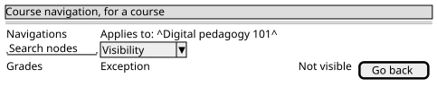

# UC-007 Change a navigation for a category, a course or an activity

| Overview | Requirements | Analysis | Design | Implementation | Tests |
| --- | --- | --- | --- | --- | --- |
| [Use cases](../../use-case-overview.svg) | **Requirements** | [Analysis](../../../analysis/use-cases/setScopeException/README.md) | [Design](../../../design/use-cases/setScopeException/README.md) | [Implementation](../../../implementation/use-cases/setScopeException/README.md) | [Tests](../../../implementation/use-cases/setScopeException/README.md#tests) |

## Use-case information

| Field | Value |
| --- | --- |
| Actor | Administrator |
| Package | Navigation |
| Goal | Give a category, a course or an activity its own version of a navigation, while the rest of the site keeps the navigation of the site. |
| Type | Primary, essential |
| Level | User goal |
| Requirement | RF-008 |
| Domain entities | Node, Scope, Menu, Visibility |

## Context

A category, a course or an activity sometimes needs another order, other names or other nodes than the site. An administrator sets an exception for it; everything inside a category follows it, and a course can change what its category sets.

## Preconditions

- The administrator holds `local/extendednav:manage`, or is a site administrator.
- The navigation is the one of a course, an activity or a category.

## Postconditions

- Success: the category or the course has its own rows, and its pages show them.
- Failure: the scope keeps following the site.

## Main flow

| Step | Actor | System |
| --- | --- | --- |
| 1 | Opens **Applies to** and searches for a category, a course or an activity. | Lists the scopes that have changes and the ones the search finds. |
| 2 | Chooses the scope. | Lists what its pages show: the nodes of the site and the ones it inherits, marked as exception or inherited. |
| 3 | Hides, moves or edits a node. | Makes a row of the scope as a copy of the node it replaces, if it has none, and changes it. |
| 4 | Goes back to the site for a node. | Deletes the row of the scope, and the node is the one of the site again. |

## Alternative flows

| ID | Starts at step | Condition | Behaviour | Ends |
| --- | --- | --- | --- | --- |
| A1 | 2 | The navigation has no exceptions (primary, user menu, administration). | The page offers no scope. | Step 1 |
| A2 | 1 | The search finds nothing. | The menu says that no category or course matches. | Step 1 |
| A3 | 1 | The scope is a user. | Only the Preferences page can change, from the Preferences of that user; no list offers every user. | Step 1 |
| A4 | 3 | The person lacks the capability of that kind of change. | The fields of that change are not in the form and the action is not offered. | Step 3 |

## Business rules

| ID | Rule |
| --- | --- |
| RN-012 | The nearest scope to a page wins for each node: the course, then the categories around it, then the site. |
| RN-013 | When a scope changes the order of any node, it sets the order of its whole navigation. |
| RN-014 | Deleting a node of the site deletes its exceptions. |
| RN-036 | In a category, a course or an activity each kind of change has its own capability; a user holds only the ones to arrange their own page. |

## Specification

Behaviour source of truth: [specification.puml](./specification.puml)

## Wireframes

