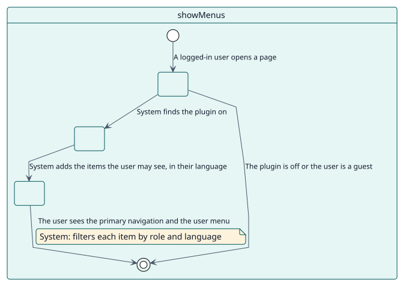
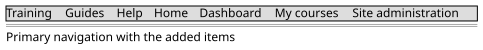

# UC-004 Show the menus of a user

| Overview | Requirements | Analysis | Design | Implementation | Tests |
| --- | --- | --- | --- | --- | --- |
| [Use cases](../../use-case-overview.svg) | **Requirements** | [Analysis](../../../analysis/use-cases/showMenus/README.md) | [Design](../../../design/use-cases/showMenus/README.md) | [Implementation](../../../implementation/use-cases/showMenus/README.md) | [Tests](../../../implementation/use-cases/showMenus/README.md#tests) |

## Use-case information

| Field | Value |
| --- | --- |
| Actor | System |
| Package | Display |
| Goal | Show each user the items that their roles and language allow. |
| Type | Primary, essential |
| Level | User goal |
| Requirement | RF-004 |
| Domain entities | Node, Menu, Visibility, Role, Language |

## Context

On each page, Moodle asks its hooks to extend the primary navigation and to build the user menu. The plugin adds the items the user may see and leaves the rest out.

## Preconditions

- The plugin is enabled.
- The user is logged in and is not the guest.

## Postconditions

- Success: the primary navigation and the user menu show the items of the user, in order.
- Failure: Moodle shows its navigation unchanged.

## Main flow

| Step | Actor | System |
| --- | --- | --- |
| 1 |  | Receives the hook that extends the primary navigation. |
| 2 |  | Checks that the plugin is on and that the user is logged in. |
| 3 |  | Reads the nodes of the menu and keeps those that the user may see, in the language of the user. |
| 4 |  | Adds them to the primary navigation and builds the user menu for the user. |

## Alternative flows

| ID | Starts at step | Condition | Behaviour | Ends |
| --- | --- | --- | --- | --- |
| A1 | 2 | The plugin is off, or the user is a guest. | Does nothing. | End |
| A2 | 3 | A parent is hidden. | Leaves its submenu out. | Step 4 |
| A3 | 4 | The page is an administration settings page. | Restores the real menu settings, so the form shows them. | End |

## Business rules

| ID | Rule |
| --- | --- |
| RN-001 | A node is shown when its visibility and its languages allow the user. |
| RN-008 | An item of Moodle with empty fields keeps the values of Moodle. |

## Specification

Behaviour source of truth: [specification.puml](./specification.puml)

## Wireframes

