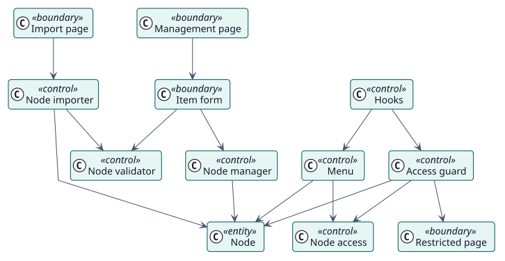

# Análisis

## Clases de análisis

Estereotipos: `<<boundary>>` interfaz, `<<control>>` coordinación, `<<entity>>` información del dominio.

| Clase | Estereotipo | Responsabilidad |
| --- | --- | --- |
| Página de gestión, Formulario del elemento, Página de importación, Página restringida | frontera | Las pantallas con las que trabajan los administradores y la página que explica a un usuario bloqueado. |
| Gestor de nodos | control | Crea, cambia, elimina y reordena nodos. |
| Validador de nodos | control | Rechaza los nodos que no son válidos. |
| Importador de nodos | control | Importa y exporta nodos, comprobando antes todo el archivo. |
| Ganchos | control | Construyen los menús y comprueban cada página cuando Moodle lo pide. |
| Menú | control | Coloca los nodos de un menú donde Moodle los espera. |
| Acceso a nodos | control | Indica si un nodo se muestra a un usuario y a un idioma. |
| Guardia de acceso | control | Decide si una página está bloqueada y adónde enviar al usuario. |
| Nodo | entidad | La información almacenada. |

## Realizaciones de casos de uso

| ID | Caso de uso | Colaboración |
| --- | --- | --- |
| UC-001 | [Añadir, cambiar o eliminar un elemento](./use-cases/manageNodes/README.md) | [colaboración](./use-cases/manageNodes/collaboration.svg) |
| UC-002 | [Reordenar los elementos](./use-cases/reorderNodes/README.md) | [colaboración](./use-cases/reorderNodes/collaboration.svg) |
| UC-003 | [Importar y exportar elementos](./use-cases/importNodes/README.md) | [colaboración](./use-cases/importNodes/collaboration.svg) |
| UC-004 | [Mostrar los menús de un usuario](./use-cases/showMenus/README.md) | [colaboración](./use-cases/showMenus/collaboration.svg) |
| UC-005 | [Bloquear las páginas de los elementos ocultos](./use-cases/blockUrl/README.md) | [colaboración](./use-cases/blockUrl/collaboration.svg) |
