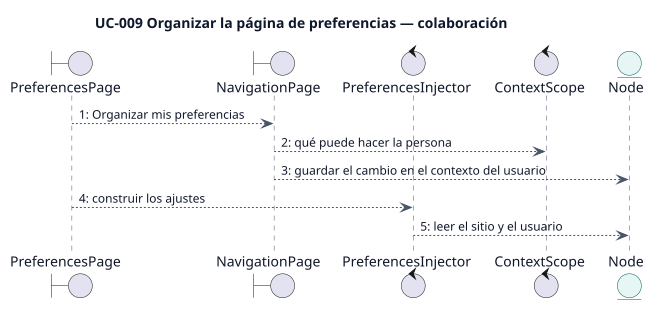

# UC-009 Organizar la página de preferencias — realización de análisis

| Vista general | Requisitos | Análisis | Diseño | Implementación | Pruebas |
| --- | --- | --- | --- | --- | --- |
| [Casos de uso](../../../requirements/use-case-overview.svg) | [Requisitos](../../../requirements/use-cases/arrangePreferences/README.md) | **Análisis** | [Diseño](../../../design/use-cases/arrangePreferences/README.md) | [Implementación](../../../implementation/use-cases/arrangePreferences/README.md) | [Pruebas](../../../implementation/use-cases/arrangePreferences/README.md#tests) |

Requisitos: [README](../../../requirements/use-cases/arrangePreferences/README.md)

## Clases participantes

| Clase | Estereotipo | Responsabilidad |
| --- | --- | --- |
| PreferencesPage | boundary | La página de preferencias de Moodle, con la sección del plugin. |
| NavigationPage | boundary | La lista de secciones y opciones, en el contexto del usuario. |
| PreferencesInjector | control | Lee las secciones y opciones de los ajustes de un usuario y aplica lo que el sitio y el usuario cambiaron. |
| ContextScope | control | Indica qué puede hacer la persona en el contexto de un usuario. |
| Node | entity | La fila de una sección o de una opción. |

## Colaboración

## Notas

El menú de usuario y el perfil no forman parte de este caso de uso: el perfil lo construye Moodle y conserva sus cuadros.
