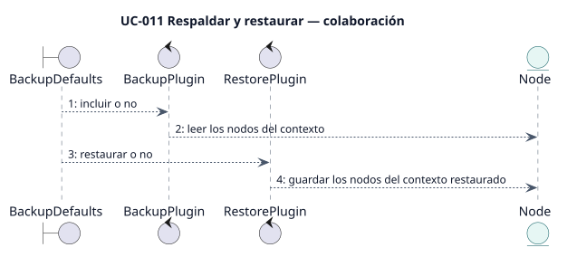

# UC-011 Respaldar y restaurar los cambios de un curso — realización de análisis

| Vista general | Requisitos | Análisis | Diseño | Implementación | Pruebas |
| --- | --- | --- | --- | --- | --- |
| [Casos de uso](../../../requirements/use-case-overview.svg) | [Requisitos](../../../requirements/use-cases/backUpChanges/README.md) | **Análisis** | [Diseño](../../../design/use-cases/backUpChanges/README.md) | [Implementación](../../../implementation/use-cases/backUpChanges/README.md) | [Pruebas](../../../implementation/use-cases/backUpChanges/README.md#tests) |

Requisitos: [README](../../../requirements/use-cases/backUpChanges/README.md)

## Clases participantes

| Clase | Estereotipo | Responsabilidad |
| --- | --- | --- |
| BackupDefaults | boundary | Los valores predeterminados de las copias y de las restauraciones. |
| BackupPlugin | control | Añade a la copia los nodos del contexto. |
| RestorePlugin | control | Lee los nodos y los entrega al contexto restaurado. |
| Node | entity | Un cambio del curso o de una actividad. |

## Colaboración

## Notas

Los cambios se leen y se escriben por contexto, así que la copia de una actividad contiene solo los cambios de esa actividad.
