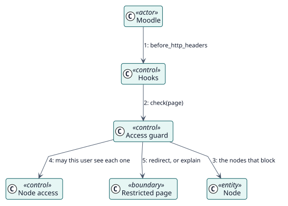

# UC-005 Bloquear las páginas de los elementos ocultos — realización del análisis

| Resumen | Requisitos | Análisis | Diseño | Implementación | Pruebas |
| --- | --- | --- | --- | --- | --- |
| [Casos de uso](../../../requirements/use-case-overview.svg) | [Requisitos](../../../requirements/use-cases/blockUrl/README.md) | **Análisis** | [Diseño](../../../design/use-cases/blockUrl/README.md) | [Implementación](../../../implementation/use-cases/blockUrl/README.md) | [Pruebas](../../../implementation/use-cases/blockUrl/README.md#pruebas) |

Requisitos: [README](../../../requirements/use-cases/blockUrl/README.md)

## Clases participantes

| Clase | Estereotipo | Responsabilidad |
| --- | --- | --- |
| Ganchos | control | Ejecutan la guardia antes de cada página. |
| Guardia de acceso | control | Decide si la página está bloqueada y adónde enviar al usuario. |
| Acceso a nodos | control | Indica si el usuario ve cada nodo. |
| Página restringida | frontera | Explica que la página no está disponible. |
| Nodo | entidad | Los elementos que bloquean. |

## Colaboración

## Notas

Una URL con parámetros solo bloquea las páginas que los tienen.
