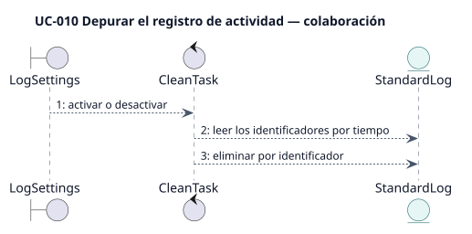

# UC-010 Depurar el registro de actividad — realización de análisis

| Vista general | Requisitos | Análisis | Diseño | Implementación | Pruebas |
| --- | --- | --- | --- | --- | --- |
| [Casos de uso](../../../requirements/use-case-overview.svg) | [Requisitos](../../../requirements/use-cases/cleanActivityLog/README.md) | **Análisis** | [Diseño](../../../design/use-cases/cleanActivityLog/README.md) | [Implementación](../../../implementation/use-cases/cleanActivityLog/README.md) | [Pruebas](../../../implementation/use-cases/cleanActivityLog/README.md#tests) |

Requisitos: [README](../../../requirements/use-cases/cleanActivityLog/README.md)

## Clases participantes

| Clase | Estereotipo | Responsabilidad |
| --- | --- | --- |
| LogSettings | boundary | La página de los ajustes del registro de actividad. |
| CleanTask | control | Se activa y desactiva con los ajustes y elimina las entradas antiguas. |
| StandardLog | entity | El registro de Moodle, donde están las entradas. |

## Colaboración

## Notas

El avance se guarda en el ajuste `logretention_done`; cambiar el tiempo conservado no hace que la tarea lea el registro de nuevo desde el principio.
