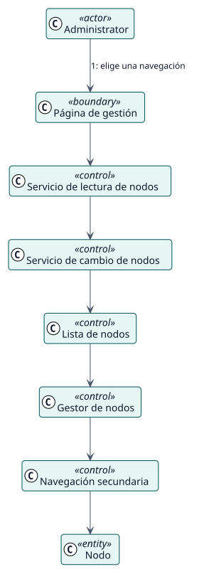

# UC-006 Personalizar una navegación secundaria — realización del análisis

| Resumen | Requisitos | Análisis | Diseño | Implementación | Pruebas |
| --- | --- | --- | --- | --- | --- |
| [Casos de uso](../../../requirements/use-case-overview.svg) | [Requisitos](../../../requirements/use-cases/customiseSecondaryNavigation/README.md) | **Análisis** | [Diseño](../../../design/use-cases/customiseSecondaryNavigation/README.md) | [Implementación](../../../implementation/use-cases/customiseSecondaryNavigation/README.md) | [Pruebas](../../../implementation/use-cases/customiseSecondaryNavigation/README.md#tests) |

Requisitos: [README](../../../requirements/use-cases/customiseSecondaryNavigation/README.md)

## Clases participantes

| Clase | Estereotipo | Responsabilidad |
| --- | --- | --- |
| Página de gestión | boundary | Lista las navegaciones y los nodos, y envía cada cambio. |
| Servicio de lectura de nodos | control | Devuelve una página de nodos con las cuentas de cada visibilidad. |
| Servicio de cambio de nodos | control | Muestra, oculta, elimina y mueve nodos. |
| Lista de nodos | control | Filtra los nodos y describe cada fila. |
| Gestor de nodos | control | Escribe las filas y el orden. |
| Navegación secundaria | control | Aplica los nodos a la navegación de una página. |
| Nodo | entity | Un nodo de una navegación y sus reglas. |

## Colaboración

