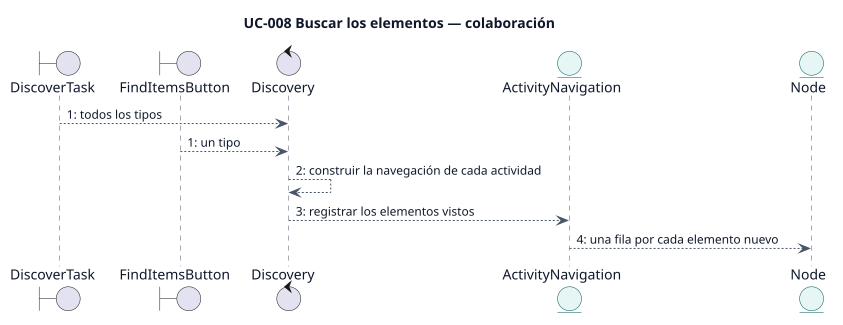

# UC-008 Buscar los elementos de la navegación de cada tipo de actividad — realización de análisis

| Vista general | Requisitos | Análisis | Diseño | Implementación | Pruebas |
| --- | --- | --- | --- | --- | --- |
| [Casos de uso](../../../requirements/use-case-overview.svg) | [Requisitos](../../../requirements/use-cases/discoverActivityItems/README.md) | **Análisis** | [Diseño](../../../design/use-cases/discoverActivityItems/README.md) | [Implementación](../../../implementation/use-cases/discoverActivityItems/README.md) | [Pruebas](../../../implementation/use-cases/discoverActivityItems/README.md#tests) |

Requisitos: [README](../../../requirements/use-cases/discoverActivityItems/README.md)

## Clases participantes

| Clase | Estereotipo | Responsabilidad |
| --- | --- | --- |
| DiscoverTask | boundary | Inicia la búsqueda una vez al día, como administrador. |
| FindItemsButton | boundary | Inicia la búsqueda de un tipo desde su lista. |
| Discovery | control | Toma las actividades de un tipo y construye su navegación. |
| ActivityNavigation | entity | La navegación de un tipo de actividad, con los elementos encontrados. |
| Node | entity | La fila de un elemento, que se puede cambiar. |

## Colaboración

## Notas

La navegación se construye, nunca se muestra: nada llega a un navegador y las actividades no cambian.
