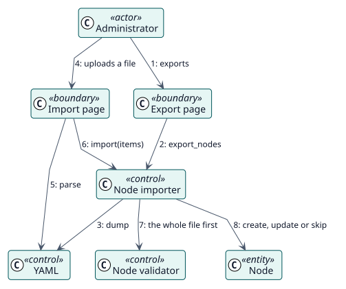

# UC-003 Importar y exportar elementos — realización del análisis

| Resumen | Requisitos | Análisis | Diseño | Implementación | Pruebas |
| --- | --- | --- | --- | --- | --- |
| [Casos de uso](../../../requirements/use-case-overview.svg) | [Requisitos](../../../requirements/use-cases/importNodes/README.md) | **Análisis** | [Diseño](../../../design/use-cases/importNodes/README.md) | [Implementación](../../../implementation/use-cases/importNodes/README.md) | [Pruebas](../../../implementation/use-cases/importNodes/README.md#pruebas) |

Requisitos: [README](../../../requirements/use-cases/importNodes/README.md)

## Clases participantes

| Clase | Estereotipo | Responsabilidad |
| --- | --- | --- |
| Página de importación | frontera | Recoge el archivo y la elección. |
| Página de exportación | frontera | Descarga el archivo. |
| YAML | control | Lee y escribe el formato. |
| Importador de nodos | control | Valida e importa, o exporta. |
| Validador de nodos | control | Rechaza los elementos no válidos. |
| Nodo | entidad | El elemento que se crea o se actualiza. |

## Colaboración

## Notas

La misma descripción de los campos se muestra en la página de importación y ofrece un archivo de ejemplo.
